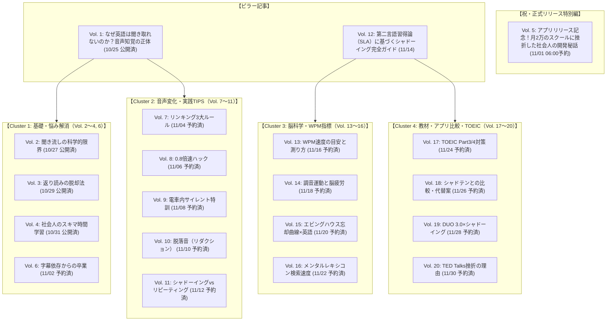

# ShadowLog 公式ブログ 編集カレンダー ＆ SEO記事企画（11月中全日予約配備版）

**更新日**: 2026年10月31日  
**投稿ペース**: 2日に1度（＋11/1 リリース記念特別編）  
**進捗ステータス**: 
- **Vol. 1〜4**: ✅ 本公開中（10/25, 10/27, 10/29, 10/31）
- **Vol. 5**: 🗓️ **2026/11/01 06:00 a.m. 公開予約済（リリース記念開発秘話）**
- **Vol. 6〜20**: 🗓️ **11月中全日程予約配備完了（先行プレビュー可能）**
**主眼**: Google SEO対策（トピッククラスター設計）、論文・第二言語習得論ベースの信頼性、最新トレンド（話題の英語本・教材）の注入、ShadowLogへの自然な導線（無料診断・Waitlist）

---

## 🗺️ 全体ロードマップ ＆ トピッククラスター設計

---

## 📅 公開スケジュール ＆ 11月中全記事一覧（全日予約完了）

| 公開日 (JST) | Vol. | スラッグ | タイトル | ステータス |
| :--- | :--- | :--- | :--- | :--- |
| **10/25 (日)** | **Vol. 1** | `/blog/why-listening-is-hard-speech-perception` | なぜ知っている単語なのに聞き取れないのか？英語リスニングの壁を壊す「音声知覚」の正体 | ✅ 公開済 |
| **10/27 (火)** | **Vol. 2** | `/blog/why-passive-listening-fails` | 「英語の聞き流し」はなぜ効果が薄いのか？脳科学（音韻ループ理論）が明かす真実 | ✅ 公開済 |
| **10/29 (木)** | **Vol. 3** | `/blog/stop-backward-translation-sight-translation` | 英語を後ろから訳していませんか？「返り読み」を強制終了して英語脳を作る方法 | ✅ 公開済 |
| **10/31 (土)** | **Vol. 4** | `/blog/busy-professional-micro-learning` | 「忙しくて英語の勉強時間が取れない」社会人が毎日10分で成果を出すマイクロラーニング術 | ✅ 公開済 |
| **11/01 (日) 06:00** | **Vol. 5** | `/blog/release-story-why-i-built-shadowlog` | **【祝・正式リリース】月2万円のスクールに挫折した社会人が、AIシャドーイング「ShadowLog」を開発した理由と開発秘話** | 🗓️ **予約済** |
| **11/02 (月) 06:00** | **Vol. 6** | `/blog/netflix-listening-without-subtitles` | Netflix英語字幕から抜け出せない人へ。「字幕なし」で洋画が観られるようになる3段階ステップ | 🗓️ 予約済 |
| **11/04 (水) 06:00** | **Vol. 7** | `/blog/english-linking-liaison-rules` | 英語の「リンキング（連結音）」完全攻略！聞き取れない音を一瞬でクリアにする3大ルール | 🗓️ 予約済 |
| **11/06 (金) 06:00** | **Vol. 8** | `/blog/shadowing-too-fast-08x-method` | シャドーイングで「舌が回らない・噛みまくる」時の解決策。効果を2倍にする【0.8倍速メソッド】 | 🗓️ 予約済 |
| **11/08 (日) 06:00** | **Vol. 9** | `/blog/silent-shadowing-commute-hack` | 満員電車やオフィスでもできる！声を出さない「サイレント・シャドーイング」の驚くべき効果 | 🗓️ 予約済 |
| **11/10 (火) 06:00** | **Vol. 10** | `/blog/english-reduction-silent-sounds` | なぜ「h」や「t」は消えるのか？リスニングを邪魔する「脱落音（リダクション）」の正体 | 🗓️ 予約済 |
| **11/12 (木) 06:00** | **Vol. 11** | `/blog/shadowing-vs-repeating-guide` | シャドーイングとリピーティング、どっちをやるべき？英語レベル別の使い分け完全ガイド | 🗓️ 予約済 |
| **11/14 (土) 06:00** | **Vol. 12** | `/blog/sla-science-of-shadowing` | 【完全解説】第二言語習得論（SLA）から見たシャドーイングの科学的効果と正しいやり方 | 🗓️ 予約済 |
| **11/16 (月) 06:00** | **Vol. 13** | `/blog/wpm-speed-benchmark-guide` | あなたの英語力は今何点？英語の処理速度を示す重要指標「WPM」の目安と測り方 | 🗓️ 予約済 |
| **11/18 (水) 06:00** | **Vol. 14** | `/blog/why-shadowing-exhausts-your-brain` | シャドーイングで脳が疲れるのは成長の証？「調音運動」とシナプス結合のメカニズム | 🗓️ 予約済 |
| **11/20 (金) 06:00** | **Vol. 15** | `/blog/ebbinghaus-spaced-repetition-english` | エビングハウスの忘却曲線をハックする！復習を自動化して「単語が抜けない脳」を作る技術 | 🗓️ 予約済 |
| **11/22 (日) 06:00** | **Vol. 16** | `/blog/speech-hesitation-mental-lexicon` | 「英語を話す時に言葉に詰まる」のはなぜ？メンタル・レキシコン（心内辞書）の検索速度を上げるトレーニング | 🗓️ 予約済 |
| **11/24 (火) 06:00** | **Vol. 17** | `/blog/toeic-listening-part3-part4-mastery` | TOEICリスニングPart 3・Part 4で満点を狙う！先読みとシャドーイングを組み合わせた攻略法 | 🗓️ 予約済 |
| **11/26 (木) 06:00** | **Vol. 18** | `/blog/shadoten-vs-ai-shadowing-comparison` | 【徹底比較】シャドテン vs AIシャドーイングアプリ！月2万円のスクールと月1,000円のAIは何が違う？ | 🗓️ 予約済 |
| **11/28 (土) 06:00** | **Vol. 19** | `/blog/duo30-distinction-shadowing-hack` | 『DUO 3.0』や『Distinction』を何周しても英語が話せない人がやるべき「音読のアップデート」 | 🗓️ 予約済 |
| **11/30 (月) 06:00** | **Vol. 20** | `/blog/why-ted-talks-shadowing-fails` | TED Talksでのシャドーイングはなぜ挫折するのか？学習効果を最大化する「教材の選び方」 | 🗓️ 予約済 |
