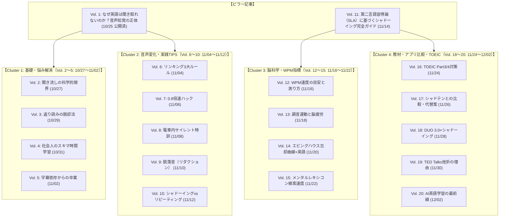

# ShadowLog 公式ブログ 編集カレンダー ＆ SEO記事企画（20本・2日に1回投稿）

**更新日**: 2026年10月25日  
**投稿ペース**: 2日に1度（2026/10/25 〜 2026/12/02 の約40日間で20記事）  
**進捗ステータス**: Vol. 1 公開完了（2026/10/25）  
**主眼**: Google SEO対策（トピッククラスター設計）、論文・第二言語習得論ベースの信頼性、最新トレンド（話題の英語本・教材）の注入、ShadowLogへの自然な導線（無料診断・Waitlist）

---

## 🗺️ 全体ロードマップ ＆ トピッククラスター設計

---

## 📅 公開スケジュール ＆ 記事詳細アイデア20選

### 【Phase 1: リスニングの壁と脳の仕組み（10/25 〜 11/02）】
まずは検索ボリュームが大きく、多くの学習者が抱える「リスニングが伸びない理由」に切り込み、ブログ全体の基盤を作ります。

---

#### 1. 【2026/10/25 (日) ★公開済】なぜ知っている単語なのに聞き取れないのか？英語リスニングの壁を壊す「音声知覚」の正体
- **URL**: `/blog/why-listening-is-hard-speech-perception`
- **ステータス**: ✅ 公開完了
- **狙うキーワード**: `英語 リスニング 聞き取れない`, `英語 リスニング 理由`, `英語 音声知覚`
- **論文・エビデンス**: 門田修平教授（関西学院大学）の「第二言語習得における音声知覚と意味理解の二段階処理モデル」
- **トレンド要素**: 話題の『100日後に英語をものにする』読者の悩み、映画・TOEICでの早口聞き取りの壁

---

#### 2. 【2026/10/27 (火)】「英語の聞き流し」はなぜ効果が薄いのか？脳科学（音韻ループ理論）が明かす真実
- **URL案**: `/blog/why-passive-listening-fails`
- **狙うキーワード**: `英語 聞き流し 効果ない`, `英語 リスニング 聞き流し 意味ない`, `音韻ループ 英語`
- **検索意図**: ラジオやポッドキャストを聞き流しているが効果が出ない。科学的な理由が知りたい
- **論文・エビデンス**: Alan Baddeley（アラン・バドリー）の「ワーキングメモリ理論」における音韻ループ（Phonological Loop）
- **記事の骨子**:
  - H2: 「BGMのように聴いていればいつか話せる」の大きな落とし穴
  - H2: ワーキングメモリの仕組み: 正しく発音できない音は「脳が雑音として破棄」する
  - H2: インプット仮説（Krashen）の誤解: 「理解可能なインプット（i+1）」と口の運動の連動
  - H2: 聞き流しを「10倍の効果」に変えるアクティブ・リスニングの3手順
- **内部リンク導線**: 聞き流しではなく「声を出して即時フィードバックを受ける」ShadowLogの練習モード紹介

---

#### 3. 【2026/10/29 (木)】英語を後ろから訳していませんか？「返り読み」を強制終了して英語脳を作る方法
- **URL案**: `/blog/stop-backward-translation-sight-translation`
- **狙うキーワード**: `英語 返り読み やめる方法`, `英語 語順のまま理解`, `サイトトランスレーション`
- **検索意図**: 長文読解やリスニングで後ろから日本語訳してしまい、スピードについていけない
- **論文・エビデンス**: スラッシュ・リーディングおよびサイトトランスレーション（Sight Translation）の同時通訳訓練モデル
- **記事の骨子**:
  - H2: なぜ日本人は無意識に「返り読み（逆戻り読解）」をしてしまうのか？
  - H2: ネイティブの語順で理解する「チャンク（意味の塊）」の捉え方
  - H2: 視覚と聴覚の強制同期: シャドーイングが返り読みを物理的に不可能にする理由
  - H2: 例文で実践する3ステップのスラッシュ訓練
- **内部リンク導線**: ShadowLogのチャンク（`/`）表示機能およびSilent Drill（語順並び替えパズル）の紹介

---

#### 4. 【2026/10/31 (土)】「忙しくて英語の勉強時間が取れない」社会人が毎日10分で成果を出すマイクロラーニング術
- **URL案**: `/blog/busy-professional-micro-learning`
- **狙うキーワード**: `社会人 英語 勉強時間 ない`, `英語学習 習慣化`, `マイクロラーニング 英語`
- **検索意図**: 仕事が忙しくて机に向かう時間が取れないが、短時間で効果的な学習法を知りたい
- **論文・エビデンス**: エビングハウスの忘却曲線と「分散学習効果（Distributed Practice Effect / Cepeda et al., 2006）」
- **記事の骨子**:
  - H2: 「週末にまとめて2時間」が挫折しやすく定着しない脳科学的理由
  - H2: 1回2分×1日3回がもたらす「記憶の検索頻度（Retrieval Practice）」の劇的向上
  - H2: 通勤・歯磨き・就寝前をトリガーにする「If-Thenプランニング（Gollwitzer）」
  - H2: スマホ1台で完結するミニマム英語ルーティン
- **内部リンク導線**: 朝・昼・夜のスキマ時間にサクッと1文吹き込めるShadowLogの機能性

---

#### 5. 【2026/11/02 (月)】Netflix英語字幕から抜け出せない人へ。「字幕なし」で洋画が観られるようになる3段階ステップ
- **URL案**: `/blog/netflix-listening-without-subtitles`
- **狙うキーワード**: `洋画 英語 聞き取れない`, `Netflix 英語学習 字幕なし`, `海外ドラマ リスニング コツ`
- **検索意図**: 英語字幕なら理解できるが、字幕を消すと途端にわからなくなる悩みを解消したい
- **論文・エビデンス**: 二重符号化理論（Dual-Coding Theory / Paivio, 1986）における視覚優位と聴覚抑制
- **記事の骨子**:
  - H2: 字幕があると「耳」ではなく「目」で理解してしまう脳の省エネ本能
  - H2: ステップ1: 英語字幕でセリフの「音」と「文字」のギャップを確認
  - H2: ステップ2: 俳優の声にかぶせる「セリフシャドーイング（オーバーラッピング）」
  - H2: ステップ3: 字幕を消して「感情とイントネーション」だけを耳で追う
- **内部リンク導線**: 実際の映画やドラマの会話スピード（160WPM〜）と自分のスピードを比べる無料診断

---

### 【Phase 2: 音声変化と即効性のある実践TIPS（11/04 〜 11/12）】
理論がわかった読者に、明日からすぐ発音やリスニングが劇的に変わる具体的なテクニックを提供します。

---

#### 6. 【2026/11/04 (水)】英語の「リンキング（連結音）」完全攻略！聞き取れない音を一瞬でクリアにする3大ルール
- **URL案**: `/blog/english-linking-liaison-rules`
- **狙うキーワード**: `英語 リンキング ルール`, `英語 音の連結`, `リエゾン 英語 聞き取り`

#### 7. 【2026/11/06 (金)】シャドーイングで「舌が回らない・噛みまくる」時の解決策。効果を2倍にする【0.8倍速メソッド】
- **URL案**: `/blog/shadowing-too-fast-08x-method`
- **狙うキーワード**: `シャドーイング 舌が回らない`, `シャドーイング 噛む`, `シャドーイング スピード ついていけない`

#### 8. 【2026/11/08 (日)】満員電車やオフィスでもできる！声を出さない「サイレント・シャドーイング」の驚くべき効果
- **URL案**: `/blog/silent-shadowing-commute-hack`
- **狙うキーワード**: `シャドーイング 声出せない`, `サイレントシャドーイング 効果`, `電車 英語勉強法`

#### 9. 【2026/11/10 (火)】なぜ「h」や「t」は消えるのか？リスニングを邪魔する「脱落音（リダクション）」の正体
- **URL案**: `/blog/english-reduction-silent-sounds`
- **狙うキーワード**: `英語 リダクション`, `英語 音の脱落`, `英語 消える音 リスニング`

#### 10. 【2026/11/12 (木)】シャドーイングとリピーティング、どっちをやるべき？英語レベル別の使い分け完全ガイド
- **URL案**: `/blog/shadowing-vs-repeating-guide`
- **狙うキーワード**: `シャドーイング リピーティング 違い`, `シャドーイング どっちがいい`, `英語 リピーティング 効果`

---

### 【Phase 3: 脳科学エビデンスとWPM（発話速度）指標（11/14 〜 11/22）】
専門的で信頼性の高い「論文・学術エビデンス」をわかりやすく解説し、他ブログと圧倒的に差別化します。

---

#### 11. 【2026/11/14 (土) ★ピラー記事】第二言語習得論（SLA）から見たシャドーイングの科学的効果と正しいやり方
- **URL案**: `/blog/sla-science-of-shadowing`
- **狙うキーワード**: `シャドーイング 効果 論文`, `第二言語習得論 シャドーイング`, `SLA 英語学習`

#### 12. 【2026/11/16 (月)】あなたの英語力は今何点？英語の処理速度を示す重要指標「WPM」の目安と測り方
- **URL案**: `/blog/wpm-speed-benchmark-guide`
- **狙うキーワード**: `WPM 英語 目安`, `WPM 測り方`, `英語 読むスピード WPM`, `WPM TOEIC スコア`

#### 13. 【2026/11/18 (水)】シャドーイングで脳が疲れるのは成長の証？「調音運動」とシナプス結合のメカニズム
- **URL案**: `/blog/why-shadowing-exhausts-your-brain`
- **狙うキーワード**: `シャドーイング 疲れる`, `英語 勉強 脳 疲労`, `調音運動 英語`

#### 14. 【2026/11/20 (金)】エビングハウスの忘却曲線をハックする！復習を自動化して「単語が抜けない脳」を作る技術
- **URL案**: `/blog/ebbinghaus-spaced-repetition-english`
- **狙うキーワード**: `エビングハウスの忘却曲線 英語`, `英語 復習 タイミング`, `スペースドリピティション 英語`

#### 15. 【2026/11/22 (日)】「英語を話す時に言葉に詰まる」のはなぜ？メンタル・レキシコン（心内辞書）の検索速度を上げるトレーニング
- **URL案**: `/blog/speech-hesitation-mental-lexicon`
- **狙うキーワード**: `英語 言葉に詰まる`, `英語 パッと出てこない`, `メンタルレキシコン 英語`

---

### 【Phase 4: 教材活用・アプリ比較・TOEIC対策（11/24 〜 12/02）】
最も購買意欲・導入意欲の高い読者層に向けて、市販教材の活用法や他サービスとの比較をフェアに提示し、ShadowLogへの登録を促します。

---

#### 16. 【2026/11/24 (火)】TOEICリスニングPart 3・Part 4で満点を狙う！先読みとシャドーイングを組み合わせた攻略法
- **URL案**: `/blog/toeic-listening-part3-part4-mastery`
- **狙うキーワード**: `TOEIC Part3 対策`, `TOEIC Part4 リスニング 伸びない`, `TOEIC シャドーイング`

#### 17. 【2026/11/26 (木)】【徹底比較】シャドテン vs AIシャドーイングアプリ！月2万円のスクールと月1,000円のAIは何が違う？
- **URL案**: `/blog/shadoten-vs-ai-shadowing-comparison`
- **狙うキーワード**: `シャドテン 比較`, `シャドテン 口コミ`, `シャドテン 高い`, `シャドテン 代替`

#### 18. 【2026/11/28 (土)】『DUO 3.0』や『Distinction』を何周しても英語が話せない人がやるべき「音読のアップデート」
- **URL案**: `/blog/duo30-distinction-shadowing-hack`
- **狙うキーワード**: `DUO3.0 シャドーイング`, `Distinction 使い方`, `単語帳 シャドーイング`

#### 19. 【2026/11/30 (月)】TED Talksでのシャドーイングはなぜ挫折するのか？学習効果を最大化する「教材の選び方」
- **URL案**: `/blog/why-ted-talks-shadowing-fails`
- **狙うキーワード**: `TED シャドーイング 難しい`, `TED 英語学習 挫折`, `シャドーイング 教材 おすすめ`

#### 20. 【2026/12/02 (水)】【2026年最新】英語学習は「AI×シャドーイング」でどう変わる？最短で英語脳を手に入れるロードマップ
- **URL案**: `/blog/future-of-ai-shadowing-2026`
- **狙うキーワード**: `AI 英語学習`, `英語 シャドーイング AI`, `英語学習 将来性`, `ShadowLog`

---

## 📈 SEO効果を最大化する執筆・運用チェックリスト

1. **URLスラッグの命名規則**:
   - 記事ごとに英語の簡潔なスラッグを付与（例: `/blog/why-listening-is-hard`, `/blog/linking-rules-guide`）。
2. **アイキャッチ・OGP画像**:
   - 各記事に視認性の高いダーク基調のタイトル入りOGP画像を配置（SNS拡散・Google Discover露出対策）。
3. **メタデータの設定**:
   - `title`: 30〜35文字以内でメインキーワードを左側に配置。
   - `description`: 80〜120文字で「読むメリット」と「検索意図への回答」を明記。
4. **内部リンク構造**:
   - 各クラスター記事（例: Vol. 2〜5）からピラー記事（Vol. 1）へ相互リンク。
   - 全記事の末尾または中盤に「無料AI診断（`/diagnosis`）」または「ShadowLog無料体験（`/practice`）」へのCTAバナーを設置。
5. **公開後のSNS連動**:
   - 記事公開当日（3日に1度）の昼12:00または夜19:00に、記事のハイライト（学術TIPS）をThreads・Instagramで要約投稿し、ブログへ送客。
