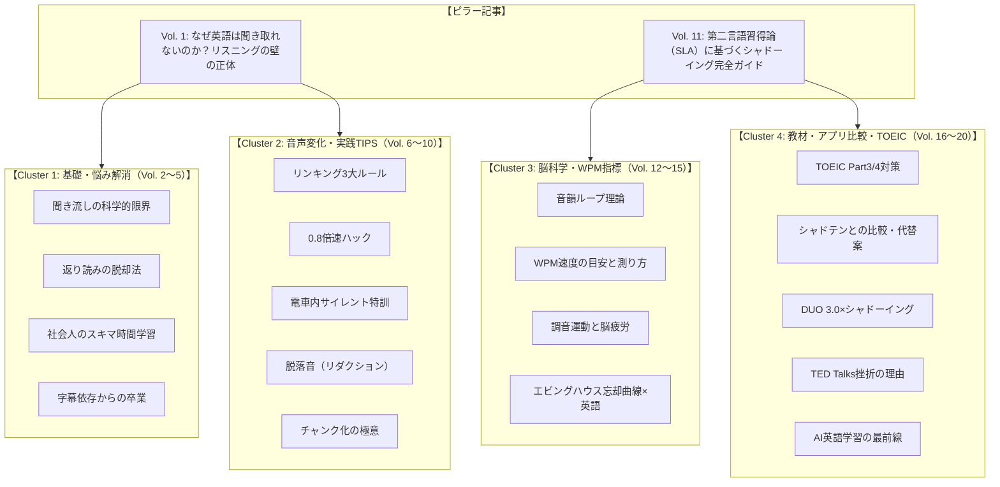

# ShadowLog 公式ブログ 編集カレンダー ＆ SEO記事企画（20本・2ヶ月計画）

**更新日**: 2026年10月25日  
**投稿ペース**: 3日に1度（約60日間で20記事）  
**主眼**: Google SEO対策（トピッククラスター設計）、論文・第二言語習得論ベースの信頼性、読者への具体的TIPS、ShadowLogへの自然な導線（無料診断・Waitlist）

---

## 🗺️ 全体ロードマップ ＆ トピッククラスター設計

---

## 📅 公開スケジュール ＆ 記事詳細アイデア20選

### 【Phase 1: リスニングの壁と脳の仕組み（Day 1〜15）】
まずは検索ボリュームが大きく、多くの学習者が抱える「リスニングが伸びない理由」に切り込み、ブログ全体の基盤を作ります。

---

#### 1. 【Day 1】なぜ知っている単語なのに聞き取れないのか？英語リスニングの壁を壊す「音声知覚」の正体
- **狙うキーワード**: `英語 リスニング 聞き取れない`, `英語 リスニング 理由`, `英語 音声知覚`
- **検索意図**: 単語は分かるのに早口になると聞き取れない原因と解決策を知りたい
- **論文・エビデンス**: 門田修平教授（関西学院大学）の「第二言語習得における音声知覚と意味理解の二段階処理モデル」
- **記事の骨子**:
  - H2: 中学レベルの単語なのに映画やネイティブ会話で聞き取れない理由
  - H2: 脳の処理限界: 「音声知覚（音を認識）」にリソースを使い果たすと「意味理解」が止まる
  - H2: 聞き取れる耳を作るには「知識（文字）」から「調音（口の動き）」への変換が不可欠
  - H2: 明日からできる1分改善法
- **内部リンク導線**: 自分の音声処理スピード（WPM）を30秒で測定できる「AI無料診断（`/diagnosis`）」へ誘導

---

#### 2. 【Day 4】「英語の聞き流し」はなぜ効果が薄いのか？脳科学（音韻ループ理論）が明かす真実
- **狙うキーワード**: `英語 聞き流し 効果ない`, `英語 リスニング 聞き流し 意味ない`, `音韻ループ 英語`
- **検索意図**: ラジオやポッドキャストを聞き流しているが効果が出ない。科学的な理由が知りたい
- **論文・エビデンス**: Alan Baddeley（アラン・バドリー）の「ワーキングメモリ理論（Working Memory Model）」における音韻ループ（Phonological Loop）
- **記事の骨子**:
  - H2: 「BGMのように聴いていればいつか話せる」の大きな落とし穴
  - H2: ワーキングメモリの仕組み: 正しく発音できない音は「脳が雑音として破棄」する
  - H2: インプット仮説（Krashen）の誤解: 「理解可能なインプット（i+1）」と口の運動の連動
  - H2: 聞き流しを「10倍の効果」に変えるアクティブ・リスニングの3手順
- **内部リンク導線**: 聞き流しではなく「声を出して即時フィードバックを受ける」ShadowLogの練習モード紹介

---

#### 3. 【Day 7】英語を後ろから訳していませんか？「返り読み」を強制終了して英語脳を作る方法
- **狙うキーワード**: `英語 返り読み やめる方法`, `英語 語順のまま理解`, `サイトトランスレーション`
- **検索意図**: 長文読解やリスニングで後ろから日本語訳してしまい、スピードについていけない
- **論文・エビデンス**: スラッシュ・リーディングおよびサイトトランスレーション（Sight Translation）の同時通訳訓練モデル
- **記事の骨子**:
  - H2: なぜ日本人は無意識に「返り読み（逆戻り読解）」をしてしまうのか？
  - H2: ネイティブの語順で理解する「チャンク（意味の塊）」の捉え方
  - H2: 視覚と聴覚の強制同期: シャドーイングが返り読みを物理的に不可能にする理由
  - H2: 例文で実践する3ステップのスラッシュ訓練
- **内部リンク導線**: ShadowLogのチャンク（`/`）表示機能およびSilent Drill（語順並び替えパズル）の紹介

---

#### 4. 【Day 10】「忙しくて英語の勉強時間が取れない」社会人が毎日10分で成果を出すマイクロラーニング術
- **狙うキーワード**: `社会人 英語 勉強時間 ない`, `英語学習 習慣化`, `マイクロラーニング 英語`
- **検索意図**: 仕事が忙しくて机に向かう時間が取れないが、短時間で効果的な学習法を知りたい
- **論文・エビデンス**: エビングハウスの忘却曲線と「分散学習効果（Distributed Practice Effect / Cepeda et al., 2006）」
- **記事の骨子**:
  - H2: 「週末にまとめて2時間」が挫折しやすく定着しない脳科学的理由
  - H2: 1回2分×1日3回がもたらす「記憶の検索頻度（Retrieval Practice）」の劇的向上
  - H2: 通勤・歯磨き・就寝前をトリガーにする「If-Thenプランニング（Gollwitzer）」
  - H2: スマホ1台で完結するミニマム英語ルーティン
- **内部リンク導線**: 朝・昼・夜のスキマ時間にサクッと1文吹き込めるShadowLogの機能性

---

#### 5. 【Day 13】Netflix英語字幕から抜け出せない人へ。「字幕なし」で洋画が観られるようになる3段階ステップ
- **狙うキーワード**: `洋画 英語 聞き取れない`, `Netflix 英語学習 字幕なし`, `海外ドラマ リスニング コツ`
- **検索意図**: 英語字幕なら理解できるが、字幕を消すと途端にわからなくなる悩みを解消したい
- **論文・エビデンス**: 二重符号化理論（Dual-Coding Theory / Paivio, 1986）における視覚優位と聴覚抑制
- **記事の骨子**:
  - H2: 字幕があると「耳」ではなく「目」で理解してしまう脳の省エネ本能
  - H2: ステップ1: 英語字幕でセリフの「音」と「文字」のギャップを確認
  - H2: ステップ2: 俳優の声にかぶせる「セリフシャドーイング（オーバーラッピング）」
  - H2: ステップ3: 字幕を消して「感情とイントネーション」だけを耳で追う
- **内部リンク導線**: 実際の映画やドラマの会話スピード（160WPM〜）と自分のスピードを比べる無料診断

---

### 【Phase 2: 音声変化と即効性のある実践TIPS（Day 16〜30）】
理論がわかった読者に、明日からすぐ発音やリスニングが劇的に変わる具体的なテクニックを提供します。

---

#### 6. 【Day 16】英語の「リンキング（連結音）」完全攻略！聞き取れない音を一瞬でクリアにする3大ルール
- **狙うキーワード**: `英語 リンキング ルール`, `英語 音の連結`, `リエゾン 英語 聞き取り`
- **検索意図**: 単語同士が繋がって別の言葉に聞こえる現象を体系的に理解したい
- **論文・エビデンス**: 調音結合（Coarticulation）および音声学における同化・連結メカニズム
- **記事の骨子**:
  - H2: ネイティブが「文字通りに発音しない」のはサボっているから？省エネ発音の原理
  - H2: ルール1: 子音＋母音の連結（Check it out ➔ チェケラウッ）
  - H2: ルール2: T/Dのフラップ化（Water ➔ ワラー）
  - H2: ルール3: 同じ音の重なり（Bad day ➔ バッデイ）
  - H2: 耳で覚えるより「自分の口で繋げて発音する」と一発で聞き取れる
- **内部リンク導線**: 30秒でリンキングの判定ができるAI発音フィードバック機能

---

#### 7. 【Day 19】シャドーイングで「舌が回らない・噛みまくる」時の解決策。効果を2倍にする【0.8倍速メソッド】
- **狙うキーワード**: `シャドーイング 舌が回らない`, `シャドーイング 噛む`, `シャドーイング スピード ついていけない`
- **検索意図**: シャドーイングをやってみたが早すぎてついていけず、挫折しそうな人向け
- **論文・エビデンス**: 運動学習（Motor Learning）における「低速での正確な筋運動定着（Slow Motion Practice）」
- **記事の骨子**:
  - H2: いきなり等倍速（100%）で練習してはいけない理由: 悪い発音癖の固定化
  - H2: 0.8倍速で調音器官（舌・唇・顎）のフォームを固める
  - H2: 0.9倍 ➔ 1.0倍 ➔ 1.1倍と負荷を上げる「オーバースピードトレーニング」
  - H2: 「噛んだ箇所」だけをピンポイントで3回リピートする部分反復法
- **内部リンク導線**: ShadowLogの再生速度調整（0.8x / 1.0x / 1.2x）とリトライ機能

---

#### 8. 【Day 22】満員電車やオフィスでもできる！声を出さない「サイレント・シャドーイング」の驚くべき効果
- **狙うキーワード**: `シャドーイング 声出せない`, `サイレントシャドーイング 効果`, `電車 英語勉強法`
- **検索意図**: カフェや通勤電車など声を出せない環境でもシャドーイングの効果を得たい
- **論文・エビデンス**: 内言語（Subvocalization / 脳内発話）と運動野（Motor Cortex）の活性化実験
- **記事の骨子**:
  - H2: 「声を出さないと意味がない」は半分ホントで半分ウソ
  - H2: 口パク（リップシンク）でも脳の言語運動野は十分に活性化する
  - H2: 電車内でできる「指先タップ×頭内シャドーイング」の具体的手順
  - H2: 夜の5分間「リアル声出し」と組み合わせる最強のハイブリッド習慣
- **内部リンク導線**: 声出し不要で語順感覚を鍛える「Silent Drill（スキマ特訓）」機能の紹介

---

#### 9. 【Day 25】なぜ「h」や「t」は消えるのか？リスニングを邪魔する「脱落音（リダクション）」の正体
- **狙うキーワード**: `英語 リダクション`, `英語 音の脱落`, `英語 消える音 リスニング`
- **検索意図**: 英文を見たら書いてあるのに、音声では完全に無視されている音の正体を知りたい
- **論文・エビデンス**: 音声学における弱化（Weakening）と脱落（Elision）
- **記事の骨子**:
  - H2: tell himが「テリム」に、last nightが「ラスナイッ」になる理由
  - H2: 代名詞（him / her / them）の先頭の音が消える法則
  - H2: 語尾の破裂音（p / t / k / b / d / g）の無音化
  - H2: 「脱落音」を意識して発音練習すると、ネイティブの速い会話がスローモーションに見える
- **内部リンク導線**: AIが弱点単語・発音脱落をハイライト表示するShadowLogの差分（Diff）画面

---

#### 10. 【Day 28】シャドーイングとリピーティング、どっちをやるべき？英語レベル別の使い分け完全ガイド
- **狙うキーワード**: `シャドーイング リピーティング 違い`, `シャドーイング どっちがいい`, `英語 リピーティング 効果`
- **検索意図**: シャドーイングとリピーティングのそれぞれのメリットと、自分に合う方を知りたい
- **論文・エビデンス**: 第二言語習得論における「注意資源の配分（Attention Allocation）」とリハーサル戦略
- **記事の骨子**:
  - H2: リピーティング＝「短期記憶（リテンション）」を鍛えるトレーニング
  - H2: シャドーイング＝「瞬発的な音声知覚（自動化）」を鍛えるトレーニング
  - H2: 初級者（TOEIC〜600点）はまずリピーティングから始めるべき理由
  - H2: 中・上級者（TOEIC 700点〜）がシャドーイングで目指すべき「プロソディ（抑揚）」の習熟
- **内部リンク導線**: 1画面で青（リピーティング）と紫（シャドーイング）を選んで録音できる2ボタン機能

---

### 【Phase 3: 脳科学エビデンスとWPM（発話速度）指標（Day 31〜45）】
専門的で信頼性の高い「論文・学術エビデンス」をわかりやすく解説し、他ブログと圧倒的に差別化します。

---

#### 11. 【Day 31】【完全解説】第二言語習得論（SLA）から見たシャドーイングの科学的効果と正しいやり方
- **狙うキーワード**: `シャドーイング 効果 論文`, `第二言語習得論 シャドーイング`, `SLA 英語学習`
- **検索意図**: シャドーイングが本当に効果があるのか、学術的な根拠と最も正しい手順を知りたい
- **論文・エビデンス**: 迫田久美子教授の研究、および門田修平『シャドーイング・音読と英語習得の科学』
- **記事の骨子**:
  - H2: なぜ通訳訓練法だったシャドーイングが一般英語学習で最も推奨されるのか？
  - H2: 「音声知覚の自動化」が生み出す、意味理解のための余剰ワーキングメモリ
  - H2: 科学的に正しいシャドーイングの5ステップ（テキスト見ない ➔ 確認 ➔ オーバーラッピング ➔ シャドーイング）
  - H2: 自己流でやってはいけない「やってはいけないシャドーイング3選」
- **内部リンク導線**: SLA理論に基づいて開発されたAIシャドーイングサービスとしてのShadowLog

---

#### 12. 【Day 34】あなたの英語力は今何点？英語の処理速度を示す重要指標「WPM」の目安と測り方
- **狙うキーワード**: `WPM 英語 目安`, `WPM 測り方`, `英語 読むスピード WPM`, `WPM TOEIC スコア`
- **検索意図**: WPM（Words Per Minute）の意味、レベル別目安、TOEICスコアとの相関を知りたい
- **論文・エビデンス**: Carver（1990）のリーディング・レート理論、ネイティブスピーチレート分析
- **記事の骨子**:
  - H2: WPMとは？「1分間に処理できる単語数」で測る真の英語運用力
  - H2: レベル別WPM一覧（初級100 / TOEIC平均130〜150 / ニュース160 / ネイティブ日常180+）
  - H2: TOEIC Part 7で塗り絵（時間切れ）になるのはWPMが120以下だから
  - H2: 自分のWPMをスマホで今すぐ無料で測定する方法
- **内部リンク導線**: 音声を吹き込むだけでWPMと推定TOEICスコアを即時算出する「無料AI診断（`/diagnosis`）」

---

#### 13. 【Day 37】シャドーイングで脳が疲れるのは成長の証？「調音運動」とシナプス結合のメカニズム
- **狙うキーワード**: `シャドーイング 疲れる`, `英語 勉強 脳 疲労`, `調音運動 英語`
- **検索意図**: シャドーイングをすると頭や口周りが異常に疲れる理由を知り、安心したい
- **論文・エビデンス**: 神経可塑性（Neuroplasticity）およびブローカ野（Broca's Area）の血流測定研究
- **記事の骨子**:
  - H2: 15分のシャドーイングが1時間の座学より疲れる科学的理由
  - H2: 日本語で使わない口の筋肉と脳の言語運動野を同時にフル稼働させる負荷
  - H2: 脳のシナプスが書き換わる「超回復」のサイン
  - H2: 疲れを溜めずに継続するための「インターバルシャドーイング法」
- **内部リンク導線**: セッション終了時に自動で成果と頑張りをグラフ化する学習完了サマリー画面

---

#### 14. 【Day 40】エビングハウスの忘却曲線をハックする！復習を自動化して「単語が抜けない脳」を作る技術
- **狙うキーワード**: `エビングハウスの忘却曲線 英語`, `英語 復習 タイミング`, `スペースドリピティション 英語`
- **検索意図**: 覚えたはずの単語やフレーズをすぐ忘れてしまう悩みを、科学的な復習周期で解決したい
- **論文・エビデンス**: 間隔反復（Spaced Repetition System / SRS）理論（Pimsleur, Wozniak）
- **記事の骨子**:
  - H2: 人間は翌日には74%忘れる: 忘れることを前提にした学習設計
  - H2: 最適な復習タイミング: 翌日 ➔ 3日後 ➔ 1週間後 ➔ 1ヶ月後
  - H2: 「噛んだ単語・間違えたフレーズ」だけを自動抽出してリベンジ出題する仕組み
  - H2: ノートを作らない！デジタル管理による復習のゼロコスト化
- **内部リンク導線**: 過去に噛んだ単語をAIが自動記録・翌日以降の文に織り交ぜる復習アルゴリズム

---

#### 15. 【Day 43】「英語を話す時に言葉に詰まる」のはなぜ？メンタル・レキシコン（心内辞書）の検索速度を上げるトレーニング
- **狙うキーワード**: `英語 言葉に詰まる`, `英語 パッと出てこない`, `メンタルレキシコン 英語`
- **検索意図**: 頭では知っているのに、いざ英会話になると言葉がスラスラ出てこない原因と改善策
- **論文・エビデンス**: 認知言語学における「メンタル・レキシコン（Mental Lexicon）」の活性化拡散モデル（Collins & Loftus）
- **記事の骨子**:
  - H2: 「単語力不足」ではない！引き出しの「インデックス検索速度」の問題
  - H2: 単語を孤立して覚えると脳内検索に時間がかかる
  - H2: コロケーション（よく使われる語の組み合わせ）を塊で覚える威力
  - H2: 1秒以内に英語を返すための「クイックレスポンス特訓」
- **内部リンク導線**: 単語をタップすると3Dカードで反転・例文と音声を即座に確認できる単語辞書機能

---

### 【Phase 4: 教材活用・アプリ比較・TOEIC対策（Day 46〜60）】
最も購買意欲・導入意欲の高い読者層に向けて、市販教材の活用法や他サービスとの比較をフェアに提示し、ShadowLogへの登録を促します。

---

#### 16. 【Day 46】TOEICリスニングPart 3・Part 4で満点を狙う！先読みとシャドーイングを組み合わせた攻略法
- **狙うキーワード**: `TOEIC Part3 対策`, `TOEIC Part4 リスニング 伸びない`, `TOEIC シャドーイング`
- **検索意図**: TOEICのリスニングスコアで伸び悩んでおり、高得点（400点以上）を突破する具体的な方法を知りたい
- **論文・エビデンス**: TOEIC公式問題集の音声速度分析（130〜155WPM）と予測文脈処理（Predictive Context Processing）
- **記事の骨子**:
  - H2: Part 3/4で設問の先読みが間に合わなくなる根本原因
  - H2: 設問を読むスピードより「音声を聞き終えた瞬間に解答できる」耳を作る
  - H2: ナレーターの息継ぎ・感情まで完全コピーするシャドーイング実況解説
  - H2: 1日1題で確実にリスニング400点を超える週間スケジュール
- **内部リンク導線**: TOEICの出題難易度（500点/700点/850点）に完全キャリブレーションされた問題バンク

---

#### 17. 【Day 49】【徹底比較】シャドテン vs AIシャドーイングアプリ！月2万円のスクールと月1,000円のAIは何が違う？
- **狙うキーワード**: `シャドテン 比較`, `シャドテン 口コミ`, `シャドテン 高い`, `シャドテン 代替`
- **検索意図**: シャドテンを検討しているが高額で迷っている。AI添削との違いやコスパを知りたい
- **論文・エビデンス**: 人手フィードバック（遅延フィードバック: 24時間後）とAI即時フィードバック（0秒フィードバック）の学習効果比較（Hattie & Timperley, 2007）
- **記事の骨子**:
  - H2: シャドテン（月21,780円）の強みと、多くの社会人が継続を断念する理由
  - H2: 最新AI（OpenAI Whisper / 音声認識）によるフィードバック精度の飛躍
  - H2: 比較表: 費用・添削スピード・教材の自由度・スキマ時間適性
  - H2: あなたはどっちを選ぶべき？タイプ別おすすめ診断
- **内部リンク導線**: シャドテン詳細比較特設ページ（`/compare/shadoten`）およびShadowLogの無料体験

---

#### 18. 【Day 52】『DUO 3.0』や『Distinction』を何周しても英語が話せない人がやるべき「音読のアップデート」
- **狙うキーワード**: `DUO3.0 シャドーイング`, `Distinction 使い方`, `単語帳 シャドーイング`
- **検索意図**: 有名な単語帳をやり込んだのにリスニングやスピーキングに生きていない人向け
- **論文・エビデンス**: 宣言的知識（Declarative Knowledge）から手続き的知識（Procedural Knowledge）への転換モデル（Anderson, ACT-R理論）
- **記事の骨子**:
  - H2: なぜ「赤シートで隠して意味を言える」だけでは実戦で使えないのか？
  - H2: 文字の知識（宣言的知識）を口の反射神経（手続き的知識）に変える手順
  - H2: DUO 3.0の560例文をシャドーイング教材として120%活かす裏ワザ
  - H2: 覚えたい3つの単語から自分専用のシャドーイング文をAI生成する方法
- **内部リンク導線**: 覚えたい3単語を指定すると自分専用のビジネス・日常文を自動生成する「カスタム生成機能」

---

#### 19. 【Day 55】TED Talksでのシャドーイングはなぜ挫折するのか？学習効果を最大化する「教材の選び方」
- **狙うキーワード**: `TED シャドーイング 難しい`, `TED 英語学習 挫折`, `シャドーイング 教材 おすすめ`
- **検索意図**: TEDでシャドーイングしようとしたが難しすぎて挫折した。最適な教材レベルを知りたい
- **論文・エビデンス**: Krashenの「i+1（インプット仮説）」と「過剰負荷仮説（Cognitive Load Theory / Sweller）」
- **記事の骨子**:
  - H2: TEDが初心者〜中級者にとって「高すぎる壁」になる理由（専門語彙＋長文）
  - H2: 脳の認知負荷（Cognitive Load）をオーバーさせない教材の3条件
  - H2: 文字で見たら「9割以上わかる」レベルを選ぶのが最短ルート
  - H2: 1文あたり15〜25語のショートスピーチから始めるメリット
- **内部リンク導線**: IT・ビジネス・マーケティング・日常の4大ジャンルから自分に合った難易度で学べる教材バンク

---

#### 20. 【Day 58】【2026年最新】英語学習は「AI×シャドーイング」でどう変わる？最短で英語脳を手に入れるロードマップ
- **狙うキーワード**: `AI 英語学習`, `英語 シャドーイング AI`, `英語学習 将来性`, `ShadowLog`
- **検索意図**: 最新のAI技術を英語学習にどう活かせば最短でペラペラになれるのか全体像を知りたい
- **論文・エビデンス**: 人工知能と適応型学習（Adaptive Learning / 個人最適化学習）の最新動向
- **記事の骨子**:
  - H2: 従来の「高額スクール通い」から「手のひらでの即時AI添削」へのパラダイムシフト
  - H2: AIがもたらす3大革命: ①0秒採点、②弱点の個別自動最適化、③月額1,000円以下の破壊的低価格
  - H2: 英語学習者が目指すべき「自動化（Automatization）」のゴール
  - H2: まとめ: 今日から始めるAIシャドーイングのロードマップ
- **内部リンク導線**: ShadowLog正式版の案内・Waitlist先行登録ページ（`/waitlist`）

---

## 📈 SEO効果を最大化する執筆・運用チェックリスト

1. **URLスラッグの命名規則**:
   - 記事ごとに英語の簡潔なスラッグを付与（例: `/blog/why-listening-is-hard`, `/blog/linking-rules-guide`）。
2. **アイキャッチ・OGP画像**:
   - 各記事に視認性の高いダーク基調のタイトル入りOGP画像を配置（SNS拡散・Google Discover露出対策）。
3. **メタデータの設定**:
   - `title`: 30〜35文字以内でメインキーワードを左側に配置。
   - `description`: 80〜120文字で「読むメリット」と「検索意図への回答」を明記。
4. **内部リンク構造**:
   - 各クラスター記事（例: Vol. 2〜5）からピラー記事（Vol. 1）へ相互リンク。
   - 全記事の末尾または中盤に「無料AI診断（`/diagnosis`）」または「ShadowLog無料体験（`/practice`）」へのCTAバナーを設置。
5. **公開後のSNS連動**:
   - 記事公開当日（3日に1度）の昼12:00または夜19:00に、記事のハイライト（学術TIPS）をThreads・Instagramで要約投稿し、ブログへ送客。
