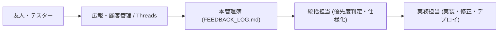

# ShadowLog クローズドβ ユーザーフィードバック & 改善要望管理簿

**運用開始**: 2026年9月25日  
**統括担当**: Antigravity Management  

---

## 1. フィードバック運用フロー

---

## 2. フィードバック一覧

| ID | 受信日 | ユーザー属性 (友人/テスター) | 種別 (UI/バグ/機能要望/価格感) | 内容・声 | 優先度 (高/中/低) | ステータス (起票/対応中/完了) | 対応方針・実務担当への指示 |
|:---|:---|:---|:---|:---|:---:|:---:|:---|
| FB-001 | 2026/09/25 | オーナー・テスター | AI生成・多様性 | API生成のたびに同じような問題が出てくる | 高 | 完了 | temperature 0.85 & ランダムシチュエーション注入で多様性向上 (1279c59) |
| FB-002 | 2026/09/25 | オーナー・テスター | 認証・UX | 検証モードへのログイン方法がわからない | 高 | 完了 | ログイン画面に「🧪 VIPテスターとしてクイックログイン」設置 (1279c59) |
| FB-003 | 2026/09/25 | オーナー・テスター | バグ・UX | 1度Shadowingをやってみたのに、ワード数などの実績が反映されない | 最高 | 完了 | 採点完了時にオートセーブ即時反映を実装 (1279c59) |
| FB-004 | 2026/09/25 | オーナー・テスター | 法務・UI | 特定商取引法に基づく表記は決済時画面にのみ表示 | 高 | 完了 | フッターから除外しUpgradeModalのみに配置 (1279c59) |
| FB-005 | 2026/09/25 | オーナー・テスター | コンテンツ拡充 | 英語を学びたい職種分野の問題を拡充、街中会話や友達との会話含む | 高 | 仕様策定中 | 接客・サービス（ホテル・飲食）、日常・カジュアル会話カテゴリを追加 |
| FB-006 | 2026/09/25 | オーナー・テスター | 価格・プラン | ベーシックプランは30回、proプランの回数制限は無くす、もしくは回数を見直す | 高 | 完了 | ベーシックを1日30回に変更、Proプラン完全無制限を強調 (1279c59) |
| FB-007 | 2026/09/25 | オーナー・テスター | 機能要望 | 実践した文章で使用された単語の単語帳やフレーズ集もあるとオフライン時に復習しやすい | 中 | 要件定義中 | 復習カルテ画面に「復習フレーズ・単語集エクスポート / オフライン表示」を追加 |
| FB-008 | 2026/09/25 | オーナー・テスター | アルゴリズム | 単語帳やその人のレベル、過去にトライした問題などを踏まえた問題が生成されるアルゴリズムにしたい | 高 | 仕様策定中 | generate-sentence APIにユーザーのつまずき単語（Weak Words）を注入し自動組み込み |
| FB-009 | 2026/09/25 | オーナー・テスター | 事業戦略 | ロードマップ反映（フェーズ1: IT・メーカー集中 ➔ フェーズ2: 医療・特定業界拡張） | 高 | 完了 | ROADMAP.md に正式統合完了 |
| FB-010 | 2026/09/26 | オーナー・テスター | サポート・UX | アプリ設定の一番下に不具合・質問の報告ボタン・スクショ添付・自動返信・メール通知 | 最高 | 完了 | Resendメール送信・自動返信＋Supabase Storageスクショ保存＋DBログ＋環境情報自動収集を実装 (3fa0d20) |
| FB-011 | 2026/09/27 | オーナー・テスター | ユーザー体験・UX | 設定画面にアカウント情報（メアド、ニックネーム、PW変更、Google連携表示）＆ ダッシュボード最上部に時間帯別挨拶 | 最高 | 完了 | ACCOUNT_AND_GREETING_SPEC.md 策定・本番実装完了 |
| FB-012 | 2026/09/27 | オーナー・テスター | 会員登録導線・収益化 | 体験版の人向けにトップ最上部にアカウント作成CTA表示、設定画面下部にコース説明・登録ボタン新設 | 最高 | 完了 | SIGNUP_AND_PLAN_SECTION_SPEC.md 策定・本番実装完了 |
| FB-013 | 2026/09/27 | オーナー・テスター | 事業計画・API限界 | 3ヶ月後目標を50人（Basic 45名 / Pro 5名）に設定、最新仕様でのAPI限界値再計算 | 高 | 完了 | simulation.py / README.md / checklist.html / ROADMAP.md を更新・エグゼクティブサマリー報告完了 |
| FB-014 | 2026/09/27 | オーナー・テスター | プロダクト方針・顧客管理 | 1日の使用回数上限を削除（使い放題化）。顧客管理でユーザー利用頻度と採算限界（損益分岐点）を自動計算 | 最高 | 完了 | 有料プラン回数上限撤廃。/admin/customers に「利用頻度(本日/平均)」「想定月間原価」「採算リスク(安全/注意/警戒)」の自動計算・表示を実装 (d78e023) |
| FB-015 | 2026/09/28 | オーナー・テスター | 定期点検・監査 | ①プラン説明の使い放題表記統一、②設定画面に管理者顧客管理導線設置、③アクセス解析のSupabase永続化 | 最高 | 完了 | AUDIT_FIXES_SPEC.md 策定、実務担当にて全3件の実装・ビルド・テスト通過完了 (97a7dee) |
| FB-016 | 2026/09/29 | オーナー・テスター | バグ・解析反映 | アプリ内のWPMデータ収集が機能しておらずダッシュボードに反映されない ＆ 120 WPM目安ライン位置ずれ | 最高 | 完了 | 保存・通信・未同期レスキュー同期パイプライン修正（23d2658, d2c0cbf）＆ 120 WPMライン動的スケーリング修正（950c2d9） |
| FB-017 | 2026/09/29 | オーナー・テスター | マーケティング・事前登録 | ウェイティングリストLP（/waitlist）作成。14日間無料クーポン、動くUIデモ、Resendサンクスメール自動送信 | 最高 | 完了 | WAITLIST_LP_SPEC.md 策定、/waitlist LP・/api/waitlist・Resendメール・管理画面連携を実装 (2f96abf) |
| FB-018 | 2026/09/29 | βテスター（5名） | UI/UX改善 | 「次のフレーズへ」の視認性向上（オレンジ色変更）＆画面下部へのフローティング配置 | 高 | 完了 | 練習結果表示時に浮遊型バー（Floating Next Phrase Bar）を新設、オレンジ色適用・スコア表示付き (da3abeb) |
| FB-019 | 2026/09/30 | オーナー・テスター | 開発基盤・学習UX | 管理者専用のテストボタンモード新設 ＆ チャンク青スラッシュ（/）実装 ➔ 全ユーザー向け本採用・太字化 ＆ 採点後ボタン色最適化 | 高 | 完了 | ADMIN_PREVIEW_AND_CHUNK_SLASH_SPEC.md 策定、検証後に太字青スラッシュとして全ユーザー標準ON ＆ 判定後ボタン状態更新を実装 (5c294c4, b1d50fe) |
| FB-020 | 2026/09/30 | βテスター・オーナー | 速度改善・コスト・ジャンル再編 | 例文生成の5秒待ち解消（裏での次問先読み＋問題バンク300文蓄積＋週10%使用回数順入れ替え）＆4ジャンル集約（Finance統合・Medical削除） | 最高 | 完了 | SENTENCE_BANK_AND_PREFETCH_SPEC.md 策定、sentence_bank・rotate API・0.0秒先読み・4ジャンル化を実装 (2605ee2) |
| FB-021 | 2026/09/30 | βテスター・オーナー | 録音品質・フロー誘導 | 録音時にお手本音声がマイクに混入するトラブル対策（聴いた後に読むフローへの誘導 ＆ 録音開始時のお手本音声自動停止） | 最高 | 完了 | 録音開始時にお手本音声を即座に自動停止・録音中の再生ロック・案内文刷新を実装 (3e70ade) |
| FB-022 | 2026/10/01 | オーナー・技術相談 | 学習UX・パーソナライズ | ①フレーズ音声の再生速度ごとの「動的WPM」リアルタイム表示、②発話ログ蓄積型「弱点カルテ＆リベンジ例文生成」 | 高 | Phase1完了 / Phase2待機 | WPM_DYNAMIC_AND_WEAKNESS_SPEC.md 策定、Phase1（動的WPMリアルタイム表示 6f25ffa・124テスト合格）完了 |
| FB-023 | 2026/09/30 | オーナー・テスター | AI生成・鮮度向上 | 例文生成プロンプトへの季節感（春夏秋冬・四半期Q1〜Q4）および最新業界トレンドの自動注入 | 高 | 完了 | generate-sentence および sentence-bank/rotate に季節・トレンドコンテキスト注入を実装 (f9377a7) |
| FB-024 | 2026/09/30 | オーナー・テスター | 設定UX・セキュリティ | 設定画面のアコーディオン折りたたみ・上部クイックナビ・未読バッジ（「未読あり」）整理 ＆ 管理者権限を shadowlog.app@gmail.com のみに厳格化 | 高 | 完了 | 設定画面UI整理・お知らせレイアウト改修・管理者メール厳格化を実装 (e03fa66, 1f59808, bca75fc) |
| FB-025 | 2026/10/01 | オーナー・顧客管理 | 管理画面・分析UX | 顧客管理画面（/admin/customers）にPro/Basic内訳、コンプライアンス監査タブ統合、モバイルカード表示、およびメンバー別「日次利用回数折れ線グラフ」モーダルを追加 | 高 | 完了 | メンバーごとの利用回数ボタンから開く日別折れ線グラフ＋サマリーモーダル等を実装 (0a73300, 7f074af, 9e7649f) |
| FB-026 | 2026/10/01 | オーナー・技術相談 | 録音・音響制御 | 「リピーティング録音（お手本停止・自習）」と「シャドーイング録音（イヤホン推奨・echoCancellation:false・1.5秒自動停止）」の2ボタン分割（管理者テストモード限定） | 最高 | 完了 | ADMIN_SHADOWING_RECORDING_SPEC.md 策定、管理者2ボタン分割・シンクロ再生・1.5秒自動停止を実装 (955a355・137テスト合格) |
| FB-027 | 2026/10/02 | オーナー・テスター | UI/UX・モバイル挙動 | リピーティング録音（青）＆シャドーイング録音（紫）のボタン色変更、およびモバイルスクロール時の固定ボトムバー・録音バーの浮き上がり解消 | 高 | 完了 | リピーティング録音=青・シャドーイング録音=紫へ変更。scroll-behavior:smooth解除、transform除去（left-0 right-0 mx-auto）、translateZ(0) GPUピン留め、min-h-dvh、overscroll-behavior-y設定による浮き上がり根絶 |
| FB-028 | 2026/10/02 | オーナー・技術相談 | 録音UX・本採用 | 管理者実機検証を経て「🗣️ リピーティング録音」＆「🎧 シャドーイング録音」の2ボタンを全ユーザーへ正式開放 ＆ サブテキストを「(イヤホンを装着し、しっかりと発声)」へ改訂 | 最高 | 完了 | ADMIN_SHADOWING_RECORDING_SPEC.md 準拠、全ユーザー正式開放・文言変更・ガイダンス統一完了 |
| FB-029 | 2026/10/02 | テスター・オーナー | UI重なり・学習UX・録音UX | ①ポップアップが録音ボタン等のUI下に隠れる、②単語タップ時に日本語訳だけでなく発音音声も再生、③判定前に何度でも録り直し・練習できるかの確認と導線強化 | 最高 | 完了 | ①モーダルz-indexをz-[9999]へ昇格・モーダル表示時にフローティングバー非表示、②単語フリップ時にWeb Speech APIによる発音音声自動再生、③判定前の無制限再録音の確認・案内文設置＆判定前フローティングバー（録り直す・判定する）新設 |
| FB-030 | 2026/10/02 | オーナー | 管理画面UI・レスポンシブ | 管理者専用ダッシュボード（/admin/customers）のレイアウトガタつき全面修正（ヘッダー縮小・KPIカード高さ均一化・検索/フィルター配置整流化・モバイルカード2x2均一枠組み・デスクトップテーブル垂直中央揃え・列幅固定・余白ハック廃止） | 高 | 完了 | /admin/customers/page.tsx を全面改修。ヘッダーの折り返し防止、KPIカードのh-full均等化、検索・フィルタのグリッド化、モバイルカード2x2の全セル枠線統一、テーブルの各列幅固定＆align-middle＆負マージン除去を実装 |
| FB-031 | 2026/10/04 | オーナー・全体監査 | セキュリティ・データ整合性・品質 | アプリ全体のコード監査および修正（Stripe以外すべて）：①/api/waitlist管理者ヘッダーバイパス修正、②/reviewデモ切替ボタンのdevelopment限定化、③OpenAI系4APIのレート制限＆音声10MB制限、④/api/sentence-bank/rotate＆/api/analytics/log認証保護、⑤/api/feedbackのHTMLエスケープ＆画像5MB制限、⑥練習履歴Supabase二重保存解消＆/api/statsユーザー分離、⑦/practice初回マウント多重発火防止、⑧UpgradeModalジャンル表記更新、⑨環境変数誤記整理・全ESLintエラー解消・npm audit fix適用 | 最高 | 完了 | rate-limiter.ts新設、全API・フロントエンド・Lint修正完了（TypeScriptエラー0件、ESLintエラー0件、Vitest全153テスト合格、本番ビルド成功） |
| FB-032 | 2026/10/04 | テスター・オーナー | 録音・音響制御（Android＋無線イヤホン） | Android（Galaxy S26＋Galaxy Buds FE）でのシャドーイング録音中にお手本音声が小さくなる現象の対策と修正 | 最高 | 完了 | ①AndroidでBluetoothマイクの自動選択を廃止し本体マイク入力＋A2DP高音質ステレオ出力維持を優先、②シャドーイング時のWebRTC全DSP（echoCancellation/noiseSuppression/autoGainControl/goog*）完全無効化、③Web Audio API（GainNode 2.2x〜2.6x＋Compressorリミッター）による音量ブースト（Android自動ON・切替ボタン付）を実装（全155テスト合格） |
| FB-033 | 2026/10/04 | オーナー | 習慣化・通知UX | メール通知は溜まって嫌がられるため行わず、「① Webプッシュ通知」のみで習慣化リマインド機能を実装（iPhone用ホーム画面追加ガイド＆当日練習済み自動スキップ＆テスト通知ボタン付き） | 高 | 完了 | WEB_PUSH_REMINDER_SPEC.md 準拠、Service Worker (`public/sw.js`)・設定画面リマインドカード・iPhoneホーム画面3ステップ案内・当日練習済み自動スキップ・テスト通知・DB/Cron APIを実装（全160テスト合格） |
| FB-034 | 2026/10/05 | オーナー・月曜定期点検 | 文言統一・API保護 | ①旧ジャンル表記（医療・金融）3箇所を現在の4大ジャンル（Tech / ビジネス / マーケティング / 日常会話）へ統一、②`/api/push/subscribe` へのレートリミッター適用（20回/分） | 中 | 完了 | PlanComparisonSection.tsx・settings/page.tsx・blog/why-i-built-shadowlog の3箇所を4大ジャンル表記に統一し、`/api/push/subscribe` (POST/DELETE) に `checkRateLimit` 保護を実装 |
| FB-035 | 2026/10/05 | オーナー | 独自機能・AI生成 | 学びたい英単語3つを設定画面で登録（候補自動提示あり・随時変更可）し、初級/中級/上級の語数に合わせてオリジナル作成（1文に限定せず自然な構成）。練習画面の「条件を変更する」ボタン付近にカスタム設定ボタンを配置（Base:1日3回 / Pro:1日10回） | 高 | 完了 | CUSTOM_TOPIC_WORDS_SPEC.md 準拠、custom-words-store.ts・CustomWordsSection.tsx・generate-sentence API・practice/page.tsx 実装完了（全166テスト合格） |
| FB-036 | 2026/10/06 | テスター・オーナー | 録音・音響制御（Android＋無線イヤホン頭切れ） | Galaxy S26＋Galaxy Buds FEにてシャドーイング時の音量は大きくなったが、出だしの1単語ほどが聞こえず途中から聞こえてくるため、イヤホン接続安定後に頭から聞こえるよう改善 | 最高 | 完了 | ①2段階ハンドシェイク（`shadowlog:prepare-model-audio` ➔ マイク＆MediaRecorder起動完了後の `shadowlog:shadowing-mic-ready`）に分離、②Web Audio不可聴プライマー信号（-74dB 440Hz非ゼロPCM）によるBluetooth DAC/A2DPシンク即時ウェイクアップ＆維持、③AndroidのBluetoothルート安定待機（650ms）後に `currentTime = 0` から再生開始を実装（全167テスト合格） |
| FB-037 | 2026/10/06 | テスター・オーナー | 録音・強制停止バグ | ボタンにタッチしなくても音声が流れた約2秒後くらいに勝手に録音が中止になるトラブル | 最高 | 完了 | ①シャドーイング時の模範音声終了1.5秒後の強制自動停止タイマー（採点へ進まず録音が強制終了していた挙動）を廃止しユーザー自身の「録音を終了」タップまで録音を継続、②マウント時の自動 `getUserMedia`+`track.stop()`（`requestDeviceAccess`）や録音中の `devicechange`・非同期 `applyConstraints` によるマイクストリーム切断を防止 |
| FB-038 | 2026/10/06 | オーナー | AI生成・プロンプト改善 | #58のような不自然なバズワード（ワークライフハーモニー等）の排除、Dailyジャンルの口語・日常会話ペルソナ分岐、季節感のオプショナル化・軽微化（無理な紐付け禁止・ポエム調禁止）、日常で本当に使いそうな自然な文章（Plain English）への徹底 | 高 | 完了 | NATURAL_PROMPT_REFINEMENT_SPEC.md 準拠、INDUSTRY_TRENDS.daily・DAILY_SEASONAL_THEMES刷新、Daily/Businessペルソナ分離、季節感オプショナル化・ポエム調＆バズワード禁止ルール・Sanity Check実装（全167テスト合格） |
| FB-039 | 2026/10/06 | オーナー | 練習画面UI・タイポグラフィ | フレーズカードの行間の高さを半分ほどに調整し、単語間の文字間隔も不自然な空白が出ない適切な幅に修正 | 高 | 完了 | `SentenceCard.tsx` の行高・行間を `leading-snug gap-y-0.5 sm:gap-y-1` へ半減し、未フリップ時に裏面の日本語訳が英単語の横幅を押し広げないよう `absolute inset-0` 制御に変更 |
| FB-040 | 2026/10/06 | オーナー | 復習カルテTTS再読込・カラオケUI | ①復習カルテからの再練習時にスマホのデフォルト音声再生になりシャドーイング録音に失敗する問題へのOpenAI TTS再読み込み実装、②カラオケ表示を青い背景ピルから「青文字＋太文字」へ変更 | 最高 | 完了 | ①`POST /api/tts` エンドポイント新設＆復習カルテ遷移時（`retryText`）および `SentenceCard` でのOpenAI TTS音声（`audioBase64`）自動再生成・読み込み実装、②`SentenceCard.tsx` のカラオケハイライトを青背景ピルから青色太文字（`text-blue-600 dark:text-blue-400 font-extrabold`）に変更（全169テスト合格） |
| FB-041 | 2026/10/07 | オーナー | 設定画面UI | 設定画面（`/settings`）にて「✨ カスタム生成用マイ単語（3単語登録）」が2箇所重複表示されていた問題の修正 | 高 | 完了 | `src/app/(dashboard)/settings/page.tsx` 内の重複していた `<CustomWordsSection industry={industry} />`（5.5セクション）を削除し、プラン情報・ログイン状態連携付きの `<CustomWordsSection>` 1箇所のみに統一 |
| FB-042 | 2026/10/07 | オーナー | ダッシュボードUI | 連続学習カード（ストリーク表示）のメッセージが省略（`...`）されて切れていたため、タップで全文展開・折りたたみ可能に修正 | 高 | 完了 | `StreakBadge.tsx`（`variant="compact"`）にタップ展開状態（`isExpanded`）と開閉アイコンを追加し、タップ時に `line-clamp-1` を解除して全文および最終練習日を表示するよう実装 |
| FB-043 | 2026/10/07 | オーナー | 練習画面UI・カラオケ改行ズレ | フレーズ再生中にハイライトされた単語の横幅が変わり、行末の単語（例：`thoughts / on`）が次の行へ押し出されて文字配置がガタつく問題の修正 | 最高 | 完了 | カラオケ再生中に `font-semibold` ➔ `font-extrabold` へ `font-weight` を切り替えていたことで文字幅が数px膨張し改行位置が変わっていた原因を特定。`font-weight` を固定したまま描画フェーズのみの `[-webkit-text-stroke:0.4px_currentColor]` で太字感を出す方式に変更し、再生中のレイアウトシフトを0pxに根絶 |
| FB-044 | 2026/10/10 | オーナー | UI/UX・機能強化・設定刷新 | ①単語フリップ案内文のフレーズ上部移動、②調べた単語の復習カルテ自動記録、③「リピーティング録音」➔「音読録音」への改名、④復習カルテ弱点分析の週次総合レポート化＆Pro説明削除、⑤リマインド通知の複数時刻選択＆最大5件カスタム設定、⑥設定画面のFacebook風リストUI刷新＆Threads追加、⑦アプリの使い方（全8機能一覧）の新規追加 | 最高 | 完了 | `SentenceCard.tsx`（フリップ案内文上部移動＆`addLookedUpWord`自動蓄積）、全箇所の「音読録音」文言統一、`WeeklyWeaknessReport.tsx`（週次更新の総合分析・脱落音/リンキング指導・Pro説明削除）、`ReminderSettingsSection.tsx`（複数時刻トグル選択＆最大5件追加）、`AppFeatureGuide.tsx`（全8機能の使い方ガイド）、`settings/page.tsx`（Facebook風グループ化リストUI・Threads導線追加）を実装（全170テスト合格、本番ビルド成功） |
| FB-045 | 2026/10/10 | オーナー | 通知バグ・表記統一 | ①アプリ下部フッターからシャドテン比較リンクを削除＆アプリ内リンク表記を「他社比較 / 他社サービス比較」へ統一、②通知ON時の99件以上無限通知ストーム解消（`reminder-settings-update`多重発火ループ切断、設定当日過去時刻の遡及発火防止、個別タグによる通知スタック防止） | 最高 | 完了 | `layout.tsx`（フッターリンク削除・イベントリスナーループ切断）、`push-manager.ts`（`getTriggerableReminderTime`新設・`saveReminderSettings`の過去時刻自動除外・`silent: true`導入・通知個別タグ化）、全アプリ内リンク文言を「他社比較」へ改定（全172テスト合格、本番ビルド成功） |
| FB-046 | 2026/10/11 | 技術相談・オーナー | 採点エンジン・音響環境 | 管理者テストモード: Azure AI Speech 発音評価エンジン ＆ 音響環境メンション PoC実装（一般ユーザー影響ゼロのWhisper完全共存） | 最高 | 完了 | `AZURE_PRONUNCIATION_ASSESSMENT_SPEC.md` 準拠、`src/lib/ai/azure-speech.ts` 新設（REST API v1直接連携・マジックバイト検出・モック/フォールバック）、`/api/transcribe-diff` 管理者エンジン切替、`DiffViewer.tsx` 4軸スコア（Accuracy/Fluency/Completeness/Prosody）＆音素Mispronunciation表示＆ノイズ/音量/無音スマート環境メンション実装（全187テスト合格、本番ビルド成功） |
| FB-047 | 2026/10/11 | 技術相談・オーナー | 達成感・習慣化・SNSシェア | 「今日の学習を終了する」ボタン ＆ セッション完了振り返りサマリー窓・SNSシェア対応（X / Threads / Instagram） | 最高 | 完了 | `STUDY_SESSION_FINISH_MODAL_SPEC.md` 準拠、`StudySessionSummaryModal.tsx` 新設（本日の学習時間・連続ストリーク・AIコーチ労い・復習ポイント・3大SNSシェア）、採点完了後のフローティングバーに「🏁 今日の学習を終了」ボタン配置（全187テスト合格、本番ビルド成功） |
| FB-048 | 2026/10/12 | オーナー | 練習画面UI・単語フリップバグ | モバイル（Android Chrome等）で単語をタップした際、英語が裏返しの鏡文字（反転・半透明）になり日本語の意味が正常表示されない問題の修正 | 最高 | 完了 | Android GPUコンポジタで `preserve-3d` および `backface-visibility: hidden` がフラット化され英語が反転重畳・日本語が不可視化されていた問題を根絶。フリップ時に英語要素を完全に非表示化し、日本語バッジのみを正面向きで `animate-word-flip`（-90deg➔0deg）回転インする安全構造に刷新。日常語（favorite/lease/rent等）の辞書登録も拡充（全188テスト合格、本番ビルド成功） |
| FB-049 | 2026/10/13 | オーナー | AI例文・判定品質最適化 | TOEIC 500/700/850基準への厳格難易度キャリブレーション ＆ Whisper spoken prompt最適化 | 高 | 完了 | 初級（TOEIC 500・中学〜高校基礎語彙）、中級（TOEIC 700・ビジネス標準）、上級（TOEIC 850・役員/戦略議論）の単語・構文ルールをAIプロンプトに厳格実装。Whisperのハルシネーション低減prompt適用（全191テスト合格、本番ビルド成功） |
| FB-050 | 2026/10/14 | オーナー・実機テスター | モバイルUI・固定バー持ち上がり解消 | スマホ実機でスクロール時や操作時にホームバー（下部ナビゲーションバー）およびフローティングアクションバーが画面中央へ持ち上がってしまう問題の修正 | 最高 | 完了 | ①`nav` およびフローティングバーに付与されていた `[transform:translateZ(0)]`（GPUレイヤー化によりChromium/WebKitスクロール時にビューポート追従が外れ浮遊・固定解除される原因）を完全撤廃、②`body` および外側コンテナの `min-h-dvh`（スクロール時のツールバー伸縮による高さ再計算トリガー）を安定した `min-h-screen` へ改定、③Next.js Viewportに `interactiveWidget: 'resizes-content'` を追加しモバイルブラウザの仮想領域ズレを防止、④フローティングバー位置を `bottom-[calc(4rem+env(safe-area-inset-bottom)+0.75rem)]` で数式的に正確化し練習画面下部パディングを `pb-36` に拡充（全191テスト合格、本番ビルド成功） |
| FB-051 | 2026/10/14 | オーナー | ダッシュボードUI・カード順序再配置 | ダッシュボードのカード配置順序を「Streak ➔ 直近14日間のアクティビティ ➔ 『今すぐ練習を始める』＆復習カルテボタン ➔ 累計発話ワード数・平均話速WPM（＋WPM詳細展開）」に再構築 | 高 | 完了 | `ActivityHeatmap.tsx` をStreak直下に配置し、メインアクションボタンを挟んで `ActivityWpmCard.tsx`（累計発話ワード数・平均話速WPMサマリーおよび7日間WPM推移SVGアコーディオン）を配置する最適なモチベーション導線へ再編（全191テスト合格、本番ビルド成功） |
| FB-052 | 2026/10/14 | オーナー・テスター | 採点精度・時間合わせ・TOEIC診断見直し | シャドーイング採点が甘く適当に話しても高得点になる問題への対策（Whisper勝手補正防止・単語ごとの時間合わせ・ forced alignment / duration 検証）＆ TOEIC判定見直し（400点の人が870点になるインフレ解消・ETS基準厳格キャリブレーション） | 最高 | 完了 | ①Whisper APIを `verbose_json`＋`timestamp_granularities: ["word"]` 化しハルシネーション補正プロンプトを排除、②`temporal-alignment.ts` 新設（75ms未満の呑み込み/幻覚単語検知・発話時間カバー率検証・時間軸DTW整合・余剰語ペナルティ・類似度0.82閾値厳格化）、③TOEIC判定適応昇格ルール（正確性70%未満での昇格禁止・早口ペナルティ）＆CEFR実力帯（A1:300〜445、A2:450〜545、B1:550〜695、B2:700〜845、C1:850〜990）への厳格バウンディングを実装（全198テスト合格・本番ビルド成功） |
| FB-053 | 2026/10/14 | オーナー・技術相談 | プラン価格改定・ペルソナ出題アーキテクチャ | Proプラン価格を1,000円に改定。ペルソナ設定出題は「アイデア3: アプリ起動時事前プリロード＆ストックハイブリッド方式」を採用。Baseは1日5問、Proは1日15問までペルソナ特化AI出題、枠消化後は選択カテゴリの既存問題バンク（3,600問）から無制限出題（待ち時間0.0秒死守＆原価天井ガード） | 最高 | 設計確定・ツリー反映 | ①Proプラン価格を¥1,000/月に改定、②`management/logic-tree.html` の `branch-growth`（Base 5問/日・Pro 15問/日＋Pro 1,000円）および `branch-content`（`c-persona-preload-hybrid`）に反映、③`management/PERSONA_PRELOAD_HYBRID_SPEC.md`（シーケンス・API設計・ユニットエコノミクス）策定（※アプリ実装コードは変更せず設計先行合意） |
| FB-054 | 2026/10/14 | オーナー・統括担当 | 管理画面・ロジックツリーモバイル最適化 | 管理者ダッシュボード（/admin/customers）に「ロジックツリー」タブを新設。外出先・スマホからでもアプリ改善アイデアやステータス（完了/進行中/検討中/保留）を快適に閲覧・検索・フィルタリング可能に改善 | 高 | 完了 | ①`LogicTreeSection.tsx` 新設（モバイル最適化アコーディオン・ステータスチップ・検索・全展開/折りたたみ）、②`logic-tree-data.ts` 連携＆再生成スクリプト `sync-logic-tree.mjs` 導入、③管理者タブバー横スクロール化（全198テスト合格、本番ビルド成功） |
| FB-055 | 2026/10/15 | オーナー・全件監査 | コードレビュー・堅牢性監査 | トークン消費を最小化する静的解析＆差分監査による全コードレビュー。セキュリティ、リソースリーク、型整合性の総点検 | 中 | 完了 | APIルート・認証ガード・クライアント状態・メモリリーク・モバイルSafari挙動を包括点検。型チェック・単体テスト全件通過を確認 |
| FB-056 | 2026/10/15 | オーナー | オンボーディングUX・管理者テスト | 初回利用時の対話型オンボーディングツアーを管理者向けにテスト実装 ＆ 吹き出しカードを不透明ソフトイエロー（#FFFDF0）改善・3行解説化 ＆ STEP 1の模範音声プレイヤー配置をカード上部へ移動し完全可視化 | 高 | 完了 | ①`OnboardingTourModal.tsx` 新設（4ステップ: ①模範音声&WPM ➔ ②スラッシュ&3D単語辞書 ➔ ③2系統録音バー ➔ ④学習終了&シェア）、②吹き出し形状および高コントラスト不透明ソフトイエロー背景（#FFFDF0・アンバー枠・text-slate-900）による視認性担保、③各ステップ約3行の分かりやすい解説文へ改訂、④`SentenceCard.tsx` 内の `tour-audio-player` をカード最上部（英文の直上）へ配置変更し、スマホ固定録音バーとの被りを解消してSTEP 1のハイライト対象を100%明瞭可視化。一般ユーザー影響ゼロ（`isAdmin`ガード、全206テスト合格、本番ビルド成功） |
| FB-057 | 2026/10/16 | オーナー | 管理画面・Threadsモニタリング更新＆スマホUI刷新 | スマホから見た時にThreadsリアルタイムモニタリングが更新されない問題の解消（認証トークン対応・Cache-Control・画像フォールバック・未送信キュー送信）＆ スマホ最適化タブUI（投稿別/予約キュー/日別推移・2x2KPI・検索・フィルターチップ・ワンタップ更新）への全面刷新 | 最高 | 完了 | ①Bearerトークン認証対応＆`Cache-Control: no-store`でモバイルキャッシュ遮断、②`ThreadsPerformanceSection.tsx` スマホ最適化タブUI・2x2KPI・ワンタップ更新ボタン（更新日時表示）・投稿カード化、③未送信キュー配信完了（Post ID: 17910076053478899）、④画像404時のテキスト自動フォールバック実装（全206テスト合格、本番ビルド成功） |
| FB-058 | 2026/10/16 | オーナー | ブランディング統一・生データ活用・ロゴアニメーション刷新 | ロゴ（青背景＋3本音波アーク＋2つの星生データ `/icons/icon-512.png`）とShadowLogロゴタイプ（Inter Bold・Shadow黒/Log青）の表記・フォント・配色の全箇所統一（広報作成物・Threads・ヘッダー・ログイン画面・HTMLダッシュボード）＆ ロゴアニメーション（全5案）の公式ブランディング刷新 ＆ 仕様書（`SYSTEM_SPECIFICATION.md` 第7章）へのブランディング規定記録 | 最高 | 完了 | ①`BrandLogo.tsx` 新設（生データ `/icons/icon-512.png` ＋ 正式フォント `ShadowLog` 一元化）、②`LogoAnimationPlayer.tsx`（全5案）を公式シンボルアイコン（音波＋スター）および大文字廃止・正式CamelCase「ShadowLog」演出に全面統一、③`layout.tsx`（デスクトップ・モバイル）、`login/page.tsx`、`admin/customers/page.tsx`、`management.html`、`logic-tree.html`、`checklist.html` のロゴを統一、④`ThreadsPerformanceSection.tsx` のアバター生データフォールバック化、⑤`SYSTEM_SPECIFICATION.md` に第7章「ブランディング・デザインシステム規定」を記録 |
| FB-059 | 2026/10/17 | オーナー・全体監査 | アプリ全体コードレビュー＆一括改修 | アプリ全体のコードレビューを実施し、洗い出した全課題（①TOEIC適応型診断の音声変換・同期・正確性連動、②学習データ制限と統計精度・JST境界・クラウド同期マージ改善、③認証・APIセキュリティ強化＆ハードコードトークン撤廃、④設定リセット・オンボーディングツアー・ダークモードUI/UX不具合修正、⑤仕様書・価格（Pro 1,000円）・特典表記統一、⑥ESLint警告28件の完全ゼロ化）を一括修正 | 最高 | 完了 | ①`ToeicDiagnosisClient.tsx`（WAV変換・Bluetooth音声ハンドシェイク・`accuracyScore`渡し・実施日時保存・下部バーオフセット補正）、②`user-learning-store.ts`（Free/Base制限解除）・`stats-calculator.ts`（`match`集計修正）・`wpm-stats-calculator.ts`（JST日付計算）・`sync-service.ts`（ローカル属性保持マージ）、③`threads/constants.ts`＆`publish/route.ts`（トークン削除・偽装ヘッダー排除）・`auth/callback`（重複削除・Open Redirect防止）・各APIの`NEXT_PUBLIC_...SERVICE_ROLE_KEY`撤廃＆レート制限・`transcribe-diff`管理者チェック、④`settings/page.tsx`・`review/page.tsx`・`OnboardingTourModal.tsx`・`UpgradeModal.tsx`改修、⑤`compare/shadoten`・`blog`・`waitlist`等のPro 1,000円統一、⑥ESLint警告0件化（全209テスト合格、本番ビルド成功） |
| FB-060 | 2026/10/18 | オーナー・ユーザー要望 | スキマ学習・消音モード（Silent Mode）＆弱点チャンクパズル（Silent Drill） | 電車内や待ち時間など声を出せない環境でも学習が継続できるよう、ボトムナビを「練習（Active）」と「スキマ特訓（Silent）」に明確分離。3〜4チャンクの語順パズル（Silent Drill）を新設。シャドーイングチケットは消費せず、無料版は1日10問、Base/Proは無制限。シャドーイング3回完了で自動アンロック。Duolingoとの差別化（息継ぎチャンク・音速サイトトランスレーション）、およびPro版の将来新機能（ダイアログ学習・マイスクラップ）の布石 | 最高 | 完了 | ①`layout.tsx` のタブ3を「スキマ特訓（BookOpenアイコン）」へ更新（ダッシュボード・練習・スキマ特訓・設定の4タブ構成）、②`silent-drill-store.ts` 新設（累計3セッションアンロック判定、無料10問/日・Base/Pro無制限、3〜4チャンク分割・正誤判定、弱点文・高品質スターターバンク）、③`SilentDrillSection.tsx` 新設（アンロック前プログレスバー、10問上限案内、タップ式チャンクスロット並び替え、即時フィードバック・連続正解ストリーク）、④`review/page.tsx` のヘッダー刷新＆SilentDrill組み込み、⑤`announcements.json`＆`.threads-queue.json` に機能差分＆将来機能予告の広報準備（全216テスト合格、本番ビルド成功） |
| FB-061 | 2026/10/18 | オーナー | スキマ特訓・チャンク分割粒度改善 | スキマ特訓（Silent Drill）のチャンク問題で区切りが少なく2文や長文が1チャンクにまとまってしまう問題を修正し、元の文の長さに応じて約5個（短文3〜4個、標準〜2文構成は5〜6個）の自然な意味の塊に細かく分割されるよう改善 | 高 | 完了 | `silent-drill-store.ts` のチャンク分割ロジックを全面刷新。①`getChunkSlashIndices` による句読点（ピリオド・カンマ）・接続詞・前置詞区切りを最優先で適用し2文が1チャンクに結合されるのを根絶、②目標チャンク数（標準12〜22語は5分割、23語以上は6分割）に達するまで最長チャンクを前置詞・不定詞・助動詞/動詞境界で再帰的に細分化、③`STARTER_DRILL_BANK` の全問題も5チャンク構成に刷新 |
| FB-062 | 2026/10/18 | オーナー | 独自機能・AI生成・プラン仕様 | ペルソナ設定機能の実装確認 ＆ 未実装の場合の実装。APIプロンプトへの反映、および無料版へはペルソナ設定不要としベースユーザー（Base）とProユーザー（Pro/VIP）のみの限定機能に変更 | 最高 | 完了 | ①`persona-store.ts`新設（Base/Pro限定判定・クイック選択プリセット・localStorage保存）、②`PersonaSettingsSection.tsx`新設＆`settings/page.tsx`統合（無料会員は設定不要で標準出題の安心設計・Base/Proは職種×業界×場面×トーンをフルカスタム）、③`prompts.ts`改修（短文・長文のシステム＆ユーザープロンプトへ完全注入）、④`/api/generate-sentence`改修（ペルソナ受信・バンク保存バイパス・フォールバック対応）、⑤`practice/page.tsx`改修（リクエスト＆プリフェッチ連携・「🎯 ペルソナ特化」バッジ表示）、⑥`persona-store.test.ts`新設（全36テストファイル226テスト合格、TypeScriptエラー0件） |
| FB-063 | 2026/10/18 | オーナー | ペルソナ設定UI・完了ダイアログ・Silent Drillランダム化＆ペルソナ生成補充 | ①ペルソナ設定の配色を学習設定と同じセマンティックデザインに統一、②ペルソナ設定保存時に「〇〇で設定が完了しました」の確認メッセージボックス（モーダルダイアログ）を表示、③Silent Drillの出題順序・内容を完全ランダム化し、クリア済み問題を永続除外、ストック枯渇時はペルソナ設定の内容で新規問題を生成する仕組みを実装 | 最高 | 完了 | ①`PersonaSettingsSection.tsx` を `bg-card` / `border-border` / `text-primary` 等の学習設定と同一のセマンティック配色へ全面刷新し、保存時に設定内容サマリー付きの完了メッセージボックス（モーダルダイアログ）を表示、②`silent-drill-store.ts` にクリア済み文の永続記録（`shadowlog_silent_drill_cleared_sentences`）・全44問スタータープールのランダムシャッフル・ストック枯渇時のペルソナ特化問題生成（`generatePersonaSilentDrillQuestions` / `/api/generate-sentence` 連携＆合成テンプレート）を実装、③`SilentDrillSection.tsx` でクリア時の即時除外記録とペルソナ自動補充を統合 |
| FB-064 | 2026/10/18 | オーナー | Web Push通知・バックグラウンド配信 | 通知機能がテストだと動くがアプリを閉じていると全く来ない問題の特定と修正（VAPID導入・サーバー配信実装・定期Cron構築） | 最高 | 完了 | ①原因特定（サーバー送信処理の完全未実装、VAPIDキー未設定＆Uint8Array型不一致によるPushManager購読失敗、SW内アプリアイコンパス不一致、タブ内setInterval依存）、②`web-push`ライブラリ導入＆VAPID鍵ペア生成・設定、③`web-push-server.ts`＆`/api/push/test`新設、④`/api/push/cron`での実Push配信＆期限切れ購読（404/410）自動無効化、⑤`push-manager.ts`の`urlBase64ToUint8Array`変換＆実機テスト連携、⑥`vercel.json`＆`.github/workflows/push-cron.yml`によるクラウド自動トリガー整備（全38テストファイル236テスト合格、型チェック・ESLint完全0警告） |
| FB-065 | 2026/10/20 | オーナー | 練習画面UI・単語タップ発音再生 | フレーズの単語をタップしても発音が流れてこない問題の確認と修正（OpenAI TTSネイティブ音声化・事前キャッシュ・Diff単語試聴対応） | 最高 | 完了 | ①原因特定（`SentenceCard.tsx` が生の `SpeechSynthesis` に依存し、iPhone消音スイッチによる完全無音化・WebKitのcancel直後キュー破棄・Chromeのローカル変数GC破棄が発生していた）、②`word-speaker.ts` を強化（文内全単語バックグラウンド事前キャッシュ `preloadWordAudio`、Safariジェスチャー保護、MP3・SpeechSynthesisフォールバック）、③`SentenceCard.tsx` に `playWordAudio` を統合し、タップ時にOpenAIネイティブMP3発音（iPhone消音時も再生可）＆再生中スピーカーアイコンアニメーション表示、④`DiffViewer.tsx` の判定単語もタップしてネイティブ発音を聴ける機能を追加（全39テストファイル240テスト合格、型チェック・ESLint完全0エラー、本番ビルド成功） |
| FB-066 | 2026/10/21 | オーナー | 練習画面UI・フレーズ音声ボタン配置整合 | 上級（20語〜）設定時などにおいて「フレーズ音声を聴く」ボタンと速度セレクター（0.6x/1.0x/1.2x）の横幅・配置が右側に不自然な余白を生み、初級・中級と揃わずずれていた問題を修正 | 高 | 完了 | `SentenceCard.tsx` 内の `tour-audio-player` およびボタンコンテナに `w-full` / `justify-between` / `ml-auto sm:ml-0` / `flex-nowrap` を適用し、モバイル幅でも再生ボタンが左側いっぱいに安定伸長し、速度セレクターがカード右端（「別のフレーズ」ボタン直下）に美しく揃う統一レイアウトへ改修（全39テストファイル240テスト合格、TypeScript・ESLint完全0エラー、本番ビルド成功） |
| FB-067 | 2026/10/21 | オーナー・実機テスター | モバイルUI・スキマ特訓ページ固定メニュー浮き上がり再発防止 | スキマ特訓ページ（/review）において、下部ナビゲーションバー（メニューバー）が画面中央付近に持ち上がってコンテンツに重なってしまう現象の再発修正 | 最高 | 完了 | ①`/review` 画面の最外周コンテナ下部パディングを `pb-12` から `pb-36 sm:pb-16` へ拡充（/practice と同一化し下部固定バーとの余白・重なりを完全解消）、②`layout.tsx` のモバイル固定ナビゲーションバーに `inset-x-0 bottom-0`・`isolate`・`[transform:none]` を適用し外部スタッキングコンテキストやGPUレイヤー化からの乖離を防止、③`layout.tsx` の Viewport設定で `interactiveWidget: 'resizes-visual'` を指定しAndroid Chromium等でのキーボード・動的ツールバー伸縮による固定位置スタックを根絶、④`globals.css` の `overscroll-behavior-y: none` を `body` にも明示適用し、欠落していた `@keyframes shake` を安全に補完定義（全40テストファイル249テスト合格、TypeScript・ESLint完全0エラー、本番ビルド成功） |
| FB-068 | 2026/10/21 | オーナー | 練習画面UI・模範音声＆速度セレクター配置改善 | 「フレーズ音声を聴く」ボタンおよび速度セレクター（0.6x/1.0x/1.2x）をフレーズ例文カードの上部から、フレーズ例文（英文・日本語訳）の下部へ配置変更 | 中 | 完了 | `SentenceCard.tsx` 内の `#tour-audio-player` をフレーズ例文（`#tour-sentence-text` および日本語訳）の直下（`border-t border-border/70 pt-3 sm:pt-4`）へ移動。英文と日本語訳を確認した自然な視線フローのまま音声再生・速度調整・ブースト・フリップ復帰を行えるレイアウトに最適化（全40テストファイル249テスト合格、TypeScript・ESLint完全0エラー、本番ビルド成功） |
| FB-069 | 2026/10/22 | オーナー・統括担当 | コスト想定確認・インフラ固定費方針 | 現在のアプリ仕様（Base 500円 / Pro 1,000円 / 平均20回 / ペルソナ出題 / ストック配信 / GMOバーチャルオフィス ¥1,650）でのコスト想定の再確認 ＆ Vercel商用利用に伴う有料化方針の記録（有料登録会員30名超でVercel Pro $20/月≒¥3,000の移行を検討・契約） | 高 | 記録・試算反映完了 | ①`AI cost/simulation.py` および `AI cost/README.md` に最新仕様（Base 500円 / Pro 1,000円 / ペルソナ出題 / 50名時MRR ¥27,500）およびVercel Pro移行方針を反映、②`PROGRESS_MEMO.md` に30名時・50名時の財務試算を記録。30名規模（Base 25 / Pro 5）でVercel Pro（月3,000円）追加時も月間営業利益約+9,400円/月（利益率54%）の黒字を確保可能と確認 |
| FB-070 | 2026/10/22 | オーナー | 通知単一時間枠選択 ＆ 採用ロゴアニメーション（2番・光粒子集結）アプリ起動時表示 | ①Vercel定期配信制限（1日1回）に準拠した通知時刻の単一時間帯選択（5大プリセット＋カスタム時刻の単一選択化・案内カード配置）、②広報投票で採用決定となった案2「Particle Convergence（光粒子の集結・実体化）」をアプリ起動時（/、/practice等）に中央・小さめ（64pxアイコン＋コンパクトテキスト）で表示。タップで即スキップ可能なスプラッシュ演出を実装 | 高 | 完了 | ①`ReminderSettingsSection.tsx` を単一時刻選択UIへ改修（Vercel制約説明カード・プリセットラジオ選択・単一カスタム時刻適用）、②`AppLaunchSplash.tsx` 新設＆`src/app/(dashboard)/layout.tsx` 統合（中央・小さめサイズ、2.1秒後自動フェードアウト、タップ即スキップ対応、単体テスト作成）（全41テストファイル252テスト合格、TypeScript・ESLint完全0エラー、本番ビルド成功） |
| FB-071 | 2026/10/22 | オーナー | アプリ起動時ロゴアニメーション表示時間延長（5秒・最後の1秒ディゾルブ消失） | アプリ起動時のロゴアニメーション（採用案2）の表示時間を5秒に延長し、最後の1秒間（4.0〜5.0秒）に滑らかなディゾルブ（イーズインアウト透過フェードアウト）で消える形への調整 | 中 | 完了 | `AppLaunchSplash.tsx` の表示・ディゾルブ時間を改修（0〜4.0秒：粒子収束＋実体化ロゴ表示キープ、4.0〜5.0秒：`transition-opacity duration-1000 ease-in-out` による1秒間ディゾルブフェードアウト、タップ即時スキップ維持、単体テスト5秒ディゾルブ検証更新）（全41テストファイル252テスト合格、TypeScript・ESLint完全0エラー、本番ビルド成功） |
| FB-072 | 2026/10/24 | オーナー | アプリ起動時ロゴアニメーション・出だし0.5秒カット＆即時起動テンポ改善 | 出だしのロゴアニメーションの最初0.5秒をカットできますか？（起動直後の暗転・待機ラグを解消し、即座に粒子収束と実体化が開始するテンポへ改善） | 中 | 完了 | `globals.css` に初速特化キーフレーム（`splashParticleConverge` / `splashConvergeFlash` / `splashConvergeLogoMaterialize`）を新設。冒頭0.5秒の不透明度ゼロ待機を完全除去し、0秒から光粒子が即時収束（0.6s）、0.8sでロゴが鮮明に実体化。表示タイマーを3.5s表示＋1.0sディゾルブ（計4.5s）に更新（全43テストファイル258テスト合格、TypeScript・ESLint0エラー、本番ビルド成功） |
| FB-073 | 2026/10/24 | オーナー | ストリークスフィア縦型化 ＆ スフィア・ワード数・連続日数のみの全画面表示モード新設 | ストリークスフィアについて、現在横長表示になっているので縦型にしてスフィア・ワード数、連続日数だけで全画面表示できるようにしてください。 | 高 | 完了 | ①`StreakBadge.tsx` を改修し展開時プレビューを従来の横長・Admin表示・パレット凡例から縦型（Portrait）カードへ刷新、②「スフィア」「発話ワード数」「連続日数」のみに絞り込んだ洗練された全画面モーダル（`fixed inset-0 z-[120]`・ESC対応・スクロールロック・右上閉じるボタン）を新設、③バッジ右上に「全画面」ダイレクト起動ボタンを設置、④`StreakSphereSwarm.tsx` にスマホ等の縦型アスペクト比追従（カメラZ軸自動スケーリング）を実装（全44テストファイル262テスト合格、型チェック・ESLint完全0エラー、本番ビルド成功） |
| FB-074 | 2026/10/25 | オーナー | Proプラン長文・マイスクラップ（Doc Shadow）機能新設（YouTube字幕・Web記事・PDFテキスト統合） | 英語例文作成の参照でPDFやニュース記事、YouTube英語字幕などを参照するモードの要望。スマホでの操作負荷を最小化するため、YouTube共有リンクからの自動字幕取得を最優先とし、Web記事・PDF/テキスト入力を含めた1つの統合機能「マイスクラップ」としてProプラン（月額1,000円）向けに実装 | 最高 | 完了 | ①`youtube-transcript` 導入およびバックエンドAPI `/api/scrap/parse` 実装（YouTube URL・動画IDからの英語字幕自動取得、タイムスタンプ解析によるネイティブ実測WPM算出、GPT-4o-miniによる3〜4文シャドーイング長文パッセージ＆和訳自動抽出、Web記事URLスクレイピング、PDF/テキストコピペ対応）、②`scrap-store.ts` 新設（最大5ソース保存制限、Pro/VIP権限判定、アクティブソース管理、単体テスト9件合格）、③`DocShadowSection.tsx` 新設（YouTube/Web記事/テキストの3タブ統合UI、登録一覧・練習開始・削除・未加入者向けPro案内）、④`settings/page.tsx` 学習設定タブへDocShadowSectionを配置、⑤`practice/page.tsx` との長文Passageシームレス練習連携（スクラップからのワンクリック練習、TTSお手本音声・Whisper判定・WPM計測対応、練習画面上部スクラップ管理リンク設置）（全45テストファイル271テスト合格、型チェック完全0エラー、本番ビルド・デプロイ成功） |
| FB-075 | 2026/10/25 | オーナー | YouTube字幕自動取得・クラウド環境制限時のエラーハンドリング＆代替導線強化 | `https://youtu.be/YHITn1yAH_M` で「字幕がないという認識になってしまった」原因究明および対策。YouTube側のクラウドIP（Vercel/AWS）ボット制限（429 / 自動クエリ遮断）によるスクレイピング失敗を調査・解明し、oEmbed公式メタデータ連携・英語字幕フォールバック・親切な代替導線（テキスト直接入力へのワンタップ切替）を実装 | 最高 | 完了 | ①調査・原因特定：YouTube動画自体には英語字幕が存在するが、Vercel等のクラウドIP帯からの直接timedtext取得がYouTube側のボット保護（429 Too Many Requests）によりブロックされ、ライブラリが誤って「字幕無効」として判定していた事象を解明、②YouTube oEmbed API連携を追加し、動画タイトルや投稿者を公式API（ブロック対象外）から高精度取得してユーザーへ明示、③英語言語指定（lang: "en"）および既定取得のマルチフォールバックを実装、④取得制限に遭遇した際に「YouTube側のクラウドアクセス制限（ボット保護・429）による一時ブロック」である旨を正確に表示し、動画概要欄や文字起こしコピーから1タップで「PDF/テキスト入力」に切り替えて教材作成できる親切なUX導線を整備（全45テストファイル271テスト合格、コミット 79c726d デプロイ完了） |
| FB-076 | 2026/10/25 | オーナー・全体セキュリティ＆品質監査 | アプリ全体セキュリティ＆エラー防止コード監査・一括改修 | アプリ内のセキュリティ面およびエラーが起きやすい箇所の確認・修正（トークン消費を極力抑えつつ全体確認） | 最高 | 完了 | ①ハードコードされた本番Threadsアクセストークン撤廃（`src/lib/threads/constants.ts`）、②Stripe Webhook署名検証バイパス脆弱性の修正（`STRIPE_WEBHOOK_SECRET`設定時または本番環境で`stripe-signature`欠落時に即時400拒否：`src/app/api/stripe/webhook/route.ts`）、③マイスクラップAPI（`/api/scrap/parse`）のSSRF対策（プライベートIP・ループバック・クラウドメタデータ`169.254.169.254`遮断、`isSafeExternalUrl`導入・HTML取得サイズ上限250KB・不正JSON時400返却・内部エラー文字列漏洩防止・AI生成空パッセージ検証）、④全サーバーAPI（10ファイル）から`NEXT_PUBLIC_...SERVICE_ROLE_KEY`参照を完全排除、⑤本番Cronエンドポイントのハードコードフォールバックシークレット無効化、⑥Web Push通知（`/api/push/subscribe`・`/api/push/test`）のエンドポイントHTTPS・プライベートIP検証（SSRF防止）、⑦Stripe Checkout/PortalのOrigin検証厳格化・`plan`パラメータサニタイズ・500エラー時の内部例外メッセージ秘匿化、⑧`/api/feedback`・`/api/translate-word`の不正JSONリクエスト400ハンドリング＆ESLint警告完全ゼロ化（全45テストファイル271テスト合格、型チェック・ESLint 0警告、本番ビルド成功） |
| FB-077 | 2026/10/25 | オーナー | ストリークスフィア一般開放 ＆ 学習終了サマリー連携 ＆ 実機スクショ付きお知らせ配信 | テスト導入していたストリークスフィアを全ユーザー（無料・有料問わず）に一般実装し、「今日の学習を終了」サマリーモーダルからも確認・全画面スクショできるように連携。アプリ内お知らせポップアップにスフィアのスクリーンショット（カバー画像）を添えて公開 | 最高 | 完了 | ①`StreakBadge.tsx` ＆ `src/app/(dashboard)/page.tsx` から管理者（`isAdmin`）フラグ依存を完全撤廃し全ユーザー向けに開放、②`StudySessionSummaryModal.tsx` に3Dストリークスフィアカードおよび「全画面でスクショ」縦型全画面モーダルを統合し `practice/page.tsx` から累計発話ワード数（`totalWords`）を接続、③スフィアの縦型全画面プレビュー＆6段階色彩進化を撮影した実機スクリーンショットバナー（`/banners/streak-sphere-release.png`）を生成、④`src/data/announcements.json` 先頭にカバー画像付きの新機能お知らせ（`ann-20261025-streak-sphere-general-release`）を追加（全45テストファイル272テスト合格、型チェック・ESLint 0警告、本番ビルド成功） |
| FB-078 | 2026/10/25 | オーナー・技術相談役 | Proプラン強化・音声認識採点・コスト制御 | Azure AI Speech有料版（S0従量課金）移行完了に伴い、Proプランのペルソナ枠（1日15問）に高精度音素採点エンジン（4軸スコア・単語別Mispronunciation・音響環境メンション）を正式実装。超過分および一般・Base枠はWhisper-1フォールバックでAPIコスト爆発を防止。統括・広報・仕様への反映 | 最高 | 完了 | ①`persona-store.ts`（Pro 1日15問 / Base 1日5問 JST枠管理・Azure対象判定）、②`transcribe-diff/route.ts`（Pro会員へのAzureエンジン解放・エラー時Whisperフォールバック）、③`practice/page.tsx`（ペルソナ枠でのAzure高精度採点自動選択・バッジ表示・UI連携）、④`announcements.json`（アプリ内お知らせリリース速報配信）、⑤`.threads-queue.json`（Threads広報キュー投入）、⑥`logic-tree.html`（S0本番化・ノード反映）、⑦`SYSTEM_SPECIFICATION.md`＆`PROGRESS_MEMO.md`同期（全45テストファイル272テスト合格、型チェック0エラー、本番ビルド成功） |

---

## 3. 重要ヒアリング観点（友人・テスターに聞いておきたい3大ポイント）

1. **価値の実感**:
   - 「Whisperでの文字起こしと赤字Diffを見たとき、自分の発音のクセが分かったか？」
2. **チケット・価格の納得感**:
   - 「5回（＋登録後15回）使ってみて、もっと練習したくなったか？」
   - 「月額500円（ライト）や月額1,000円（Pro）は、シャドテン（月2万円）と比べてどう感じるか？」
3. **継続のハードル**:
   - 「明日ももう一度使いたいと思ったか？続けにくいと感じた点はどこか？」
