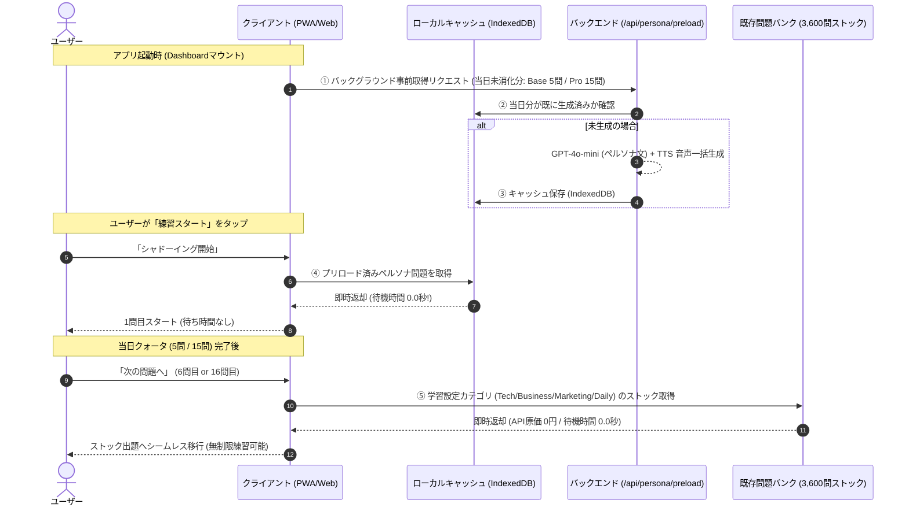

# 🚀 ペルソナ対応 ＆ 事前プリロード・ストックハイブリッド出題 仕様設計書
**文書ID**: SPEC-003  
**最終更新日**: 2026-10-14  
**ステータス**: 技術相談役協議・確定済み（設計確定 / 実装待機）  
**関連ロジックツリー**: `management/logic-tree.html` (`branch-growth`, `branch-content`)

---

## 1. 意思決定の背景と課題

ユーザーが自身の職種や業界（例: 「化学系メーカー営業×半導体」など）を登録する「ペルソナ設定」を導入するにあたり、以下の技術的・事業的課題が存在していた：

1. **待ち時間（レイテンシ）の課題**:
   - 毎回スタートボタンを押した後にGPT-4o-miniで文を生成し、OpenAI TTSで音声を生成すると、**毎問2.0〜3.5秒のロード待機時間**が発生し、シャドーイングの軽快なテンポ感が損なわれる。
2. **API原価の青天井リスク**:
   - 熱心なユーザーが1日50問〜100問練習した場合、都度生成では月間API原価が1ユーザーあたり300円〜600円に膨らみ、Baseプラン（月500円）の利益が吹き飛ぶ。

### 採用方針：【アイデア3】事前バッチ先読みストックハイブリッド方式
上記課題を両立解決するため、**「アプリ起動時の非同期バックグラウンド生成（事前準備）」＋「日次ペルソナ枠消化後の既存ストック（問題バンク）シームレス移行」**を採択。

---

## 2. プラン別クォータと出題ルール

| 項目 | 🌱 無料プラン (Free) | ⚡️ 一般プラン (Base) | 👑 プロプラン (Pro) |
| :--- | :--- | :--- | :--- |
| **月額料金 (税込)** | **¥0** | **¥500 / 月** | **¥1,000 / 月** *(※1,480円から改定)* |
| **ペルソナ特化枠** | 利用不可（ロック） | **1日 5問** まで | **1日 15問** まで (長文Passage対応) |
| **枠消化後の出題** | 1日2問/週最大5問で制限 | **無制限**（選択中カテゴリの既存ストックから出題） | **無制限**（選択中カテゴリの既存ストックから出題） |
| **出題待ち時間** | 0.0秒 (ストック配信) | **0.0秒** (事前プリロード＋ストック) | **0.0秒** (事前プリロード＋ストック) |
| **単語帳・クラウド同期** | ロック (端末一時保存) | 解禁・Supabase永続保存 | 解禁・Supabase永続保存 |
| **AI長文高精度レビュー** | なし | なし | 1日1回限定チケット制 (検討中) |

---

## 3. システムアーキテクチャ & シーケンス (アイデア3)

### 3.1. プリロードのタイミングと最適化
1. **トリガー**: アプリの起動（Dashboard画面マウント時）。
2. **非同期実行**: 画面描画や操作を一切ブロックしない（バックグラウンドワーカーまたは`useEffect`内の非同期フェッチ）。
3. **即時スタート保証**: ユーザーが起動後1秒以内に「スタート」を押した場合でも、配列のインデックス0（1問目）から順次ストリーミング受信・解決するため、待たされることはない。

---

## 4. 収益性・コスト試算 (ユニットエコノミクス)

### 4.1. 動的生成の単価前提
- 1問あたりのテキスト生成 (GPT-4o-mini): 約 ¥0.034
- 1問あたりの音声合成 (OpenAI TTS-1 / 約15〜20語): 約 ¥0.140
- **1問合計動的生成原価**: **約 ¥0.174 / 問**
- 既存ストック問題（問題バンク）の出題原価: **¥0.000 / 問**

### 4.2. プラン別月間原価上限と粗利
| プラン | 月額会費 | 月間ペルソナ生成原価上限 | 月間粗利益 | 粗利益率 |
| :--- | :--- | :--- | :--- | :--- |
| **Base (500円)** | ¥482 (Stripe差引後) | 最大 ¥26.1 (5問×30日×0.174円) ※平均受講 ¥15.7 (3問/日想定) | **約 ¥410 〜 ¥456** | **85.1% 〜 94.6%** |
| **Pro (1,000円)** | ¥964 (Stripe差引後) | 最大 ¥78.3 (15問×30日×0.174円) ※平均受講 ¥41.8 (8問/日想定) | **約 ¥805 〜 ¥922** | **83.5% 〜 95.6%** |

> [!IMPORTANT]
> **原価防御のポイント**:
> ユーザーが1日に100問練習しても、5問（Proは15問）を超えた分はすべて出題原価0円の「3,600問ストック」から配信されるため、**1ユーザーあたりの月間AI原価が絶対に26.1円（Proは78.3円）を超えない**設計となっています。

---

## 5. 技術相談役・実装担当との合意事項

1. **現状のコード（`src/`）には一切手を加えない**:
   - 本設計は `management/logic-tree.html` および本仕様書にて管理し、先行して技術ロジックの合意を完了させる。
2. **実装フェーズにおけるタスク一覧（予定）**:
   - `src/app/api/persona/preload/route.ts` の新設（日次上限チェックとバッチ生成）
   - クライアント側（PWA）のIndexedDBキュー管理（`personaQueue`）
   - 出題カウンタによるストック（`sentence_bank`）自動切替ロジック
   - 会員プラン別のクォータ定数（`BASE_PERSONA_DAILY_LIMIT = 5`, `PRO_PERSONA_DAILY_LIMIT = 15`）の適用
