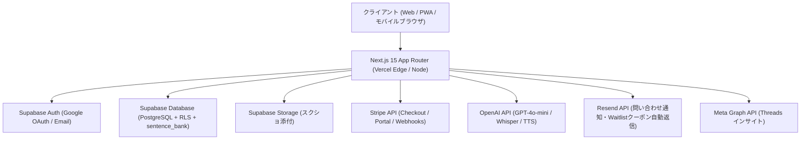

# ShadowLog (シャドーログ) サービス ＆ システム基本仕様設計書

**初版策定日**: 2026年9月27日  
**最終更新日**: 2026年10月14日（TOEIC 500/700/850語彙厳格化・Azure発音評価PoC・学習終了SNS窓・Threads24時間自動投稿・ロジックツリースタジオ反映）  
**プロダクト責任者**: プロジェクト統括担当 (Antigravity)  
**対象リポジトリ**: `ic1koala/Shadowlog`  

---

## 1. プロダクト概要 & バリュープロポジション

### ① サービスビジョン
**「英語を話したいすべての人が、挫折せず、圧倒的低価格で実践発話力を鍛えられるAIシャドーイング習慣化SaaS」**

### ② 市場のペインと差別化
- **既存の課題**:
  - 人手による高額シャドーイング添削（シャドテン: 月額21,780円）は高価格すぎて大半のビジネスパーソンが継続できない。
  - フリートーク型AI英会話（Speak等）は、自分の発音のどこが落ちているか（脱落音・連結音）が可視化されにくい。
- **ShadowLogの解決策（2026/10/14 最新仕様）**:
  - **即時Diff判定 ＆ 太字青色チャンク（`/`）全ユーザー標準表示**: 発話音声をAI文字起こしし、脱落単語・誤読単語を赤字ハイライト（凡例は書き起こし直下に配置）。さらにレイアウトズレゼロの太字青色スラッシュ（`/`）で意味の塊（チャンク）を全ユーザー向けに標準可視化。
  - **3難易度レベルの TOEIC 500 / 700 / 850 厳格語彙換算（FB-049）**: 「初級で難しい単語が出る」問題を根絶するため、初級は最頻出2,000語（NGSL Level 1）に上限設定し、-tion/-ity等の抽象名詞を完全禁止。中級はTOEIC 700点（約4,000語）、上級はTOEIC 850点以上（約8,000語）に厳格キャリブレーション。さらにWhisper音声認識プロンプトを最適化し、口語縮約形（I'm, don't）の認識揺れ・不当減点を防止。
  - **3単語マイカスタム例文生成 ＆ 難易度連動1〜2文構成（FB-035）**: 「自分が今仕事や日常で使いたい3つの単語」を設定画面に登録し、練習画面からワンタップで即時オリジナル例文と音声を動的生成。初級（10〜14語）、中級（15〜20語）、上級（21〜28語）と無理のない自然な文脈構成で実践発話練習が可能（Base: 1日3回 / Pro: 1日10回）。
  - **Azure AI Speech 音素レベル発音評価エンジン ＆ 音響環境スマートメンション PoC（FB-046）**: 「適当な発音でも高得点が出る」Whisperの文脈忖度問題を克服するため、音素（Phoneme）波形照合エンジンを管理者テストモードへ導入。Accuracy, Fluency, Completeness, Prosody 4軸採点＋単語別Mispronunciation判定＋S/N比によるノイズ/マイク距離警告を実装。
  - **「今日の学習を終了する」ボタン ＆ セッション完了振り返りサマリー窓・SNSシェア（FB-047）**: 練習画面下部に終了ボタンを新設。学習時間、連続学習ストリーク、AIコーチ労いメッセージ、復習ポイントをまとめたモーダルを表示し、𝕏 / Threads / Instagram へ成果をワンタップシェア可能。
  - **思考整理・アプリ改善ロジックツリースタジオ（FB-050）**: 5大ブランチ（品質・UX・習慣化・コンテンツ・成長）のビジュアルツリー構造で、改善アイディアや技術論点を直感的に整理・保存・ダッシュボード連携。
  - **再生速度連動「動的WPM」リアルタイム表示**: お手本音声の再生速度（0.6x / 1.0x / 1.2x）ごとに、実測音声長（`duration`）と単語数から算出した実効WPMをリアルタイムでカプセルUIに併記表示。
  - **バックグラウンド1問先読み（Prefetch 0.0秒遷移）**: 1問目を練習中に裏側で次の問題と音声を先読みキャッシュし、画面下部オレンジ色の「次のフレーズへ」バーから待ち時間 `0.0秒` で連続練習可能。
  - **4大ジャンル×300文問題バンク（計3,600文）＆ 週10%季節・トレンド自動ローテーション**: 利用頻度の高い4ジャンル（`Tech`, `Business`, `Marketing`, `Daily`）×3レベル＝12スロットに各300文を蓄積。日常会話（Daily）での平易な口語ペルソナ分岐、季節感のオプショナル化、およびバズワード排除（FB-038）により、日常で本当に使われる自然な発話フレーズを徹底生成し、0.1秒配信とAPI原価70%超削減を両立。
  - **Listen-then-Speak 音響制御 ＆ 録音・採点ボタン最適化**: 録音開始時に再生中の模範音声を自動停止し、スピーカー音のマイク回り込み（誤採点）を完全防止。
  - **圧倒的低価格 & 使い放題**: 月額500円（Base）/ 月額1,480円（Pro）で1日回数上限なしの練習環境を提供。

---

## 2. 料金プラン ＆ チケット・利用制限体系

| プラン名 | 月額料金 (税込) | 短文シャドーイング | 長文スピーチ (60〜90語) | 弱点単語帳 & カルテ | 3単語カスタム生成 | 1日練習上限 | 損益分岐限界 (蓄積期 ➔ バンク定常期) |
|:---|:---:|:---:|:---:|:---:|:---:|:---:|:---:|
| **無料体験 (ゲスト)** | 0円 | 累計 5回 | ✕ | ✕ (端末のみ) | 累計 2回 | 累計5回で終了 | N/A |
| **無料会員 (Free)** | 0円 | 累計 20回 (+15回) | 2回 (味見枠) | ◯ (クラウド同期) | 累計 2回 | 累計20回で終了 | N/A |
| **ベースプラン (Base)** | **500 円** | **無制限 (使い放題)** | ✕ | ◯ | **1日 3回 (JST)** | **上限なし** | **1日約50回 ➔ 定常期 約165回** |
| **Proプラン (Pro)** | **1,480 円** | **無制限 (使い放題)** | **無制限 (使い放題)** | ◯ (4大ジャンル可) | **1日 10回 (JST)** | **上限なし** | **1日約147回 ➔ 定常期 約490回** |

> 📌 **仕様確定事項**:
> - **1日利用上限の撤廃**: 有料プランにおける「1日20〜30回まで」等の上限設定は完全撤廃。使い放題として提供しつつ、管理者側（`/admin/customers`）で各ユーザーの利用頻度と原価リスクを保守基準（50回/147回）で自動モニタリング。
> - **クローズドβ期間限定VIPキャンペーン**: 2026年10月20日までに無料会員登録したユーザーは、**2026年10月30日まで自動的にVIP（Proプラン相当・回数無制限）** として利用可能（`vip-checker.ts` にて自動判定）。

---

## 3. AI・音響パイプライン ＆ 原価構造（2026/10/06 再計算・3単語カスタム生成込）

### ① 1回あたりのAI原価内訳 ＆ 新機能の原価影響
1. **フェーズA：バンク蓄積期・保守上限モード（各スロット300文未満時）**:
   - **Whisper-1** (音声文字起こし): 録音 約10秒 (\$0.006/分) ➔ **約 0.149 円**
   - **TTS-1** (模範音声生成・リトライ時再利用): 1文 約133文字 ➔ **約 0.150 円**
   - **GPT-4o-mini** (動的例文生成 ＆ コーチング): 弱点単語上位5語・季節トレンド注入 ➔ **約 0.024 円**
   - **蓄積期 合計実質原価**: **約 0.322 円 / 練習** (\$0.00215 @ \$1=150円)
2. **フェーズB：問題バンク定常運用モード（各スロット300文到達後＋週10%入替）★本命**:
   - **通常出題・TTS模範音声・先読み（Prefetch）原価**: `sentence_bank` から0.1秒配信のため **完全 0 円**。
   - **練習ごとの変動原価**: Whisper音声認識 ＋ GPT-4o-miniコーチ評価のみ ➔ **約 0.097 円（約0.10円）〜 0.165 円 / 練習**（従来比 **約70〜80%圧縮**）。
   - **週次10%自動ローテーション固定原価（`/api/sentence-bank/rotate`）**:
     - 各スロット30文×12スロット＝週360文（月間1,440文）を利用回数上位から入れ替え。
     - `1,440文 × 約0.23円` ＝ **月額 約 331 円 / 月（会員数に依存しない完全固定費）**。
3. **✨ 新機能：3単語カスタム例文生成（`FB-035` / `custom-words-store.ts`）の追加原価と安全キャップ**:
   - カスタム単語指定時は `sentence_bank` をバイパスし、その場で GPT-4o-mini ＋ TTS-1 を動的実行（1生成あたり **約 0.174 円**）。
   - JST 0:00 リセットの厳格なプラン別上限により、1人あたりの月間最大追加原価を完全制御：
     - **無料 / ゲスト**: **累計 2回まで**（最大 約0.35円）
     - **ベースプラン（¥500/月）**: **1日 3回まで**（月最大90回） ➔ 実効平均（1日1回）で **+5.2円/月**、毎日上限フル利用でも **最大 +15.7円/月**。
     - **Proプラン（¥1,480/月）**: **1日 10回まで**（月最大300回） ➔ 実効平均（1日3回）で **+15.7円/月**、毎日上限フル利用でも **最大 +52.2円/月**。
5. **🎤 Azure AI Speech 発音評価エンジン（`FB-046` / 管理者PoC / 将来オプション）の原価構造**:
   - **F0無料枠（毎月5時間完全無料）**: 月間約 3,600回分（5秒/回の発話時）の発音評価が **完全 0 円** で実行可能。PoC検証およびクローズドβテスト期間は追加コストゼロ。
   - **有料プラン（S0従量課金）移行時**: \$1.00 / 1時間（約 0.208 円 / 5秒発話）。Proプラン限定のプレミアム機能として提供した場合でも、十分な粗利率（75%以上）を維持可能。

### ② 運用中 AI 機能の用途別マッピング（2026/10/14 最新）

| 用途分類 | 提供元 / モデル | エンドポイント / 該当機能 | 運用ステータス / 対象 | 主な役割・特徴 |
| :--- | :--- | :--- | :--- | :--- |
| **短文・パッセージ生成** | OpenAI `gpt-4o-mini` | `/api/generate-sentence` | 本番稼働（全ユーザー） | **TOEIC 500/700/850 厳格語彙換算**（初級2,000語上限・抽象語禁止）、日常会話口語ペルソナ、3単語カスタム生成 |
| **お手本音声生成 (TTS)** | OpenAI `tts-1` | `/api/tts` | 本番稼働（全ユーザー） | 模範ネイティブ音声合成、再生速度別動的WPM算出（0.6x/1.0x/1.2x） |
| **音声認識・文字起こし (STT)** | OpenAI `whisper-1` | `/api/transcribe-diff` | 本番稼働（一般ユーザー） | ユーザー録音の文字起こし（**口語縮約形プロンプト最適化済**、回答自動補正を防止） |
| **精密発音評価 & 音響環境診断** | Microsoft Azure AI Speech | `/api/transcribe-diff` (Azure分岐) | **先行導入・検証中（管理者テスト限定）** | 音素(Phoneme)レベル照合による4軸採点（正確度・流暢さ・完全性・抑揚）、単語別誤発音判定、S/N比環境メンション |
| **AIコーチング・改善フィードバック** | OpenAI `gpt-4o-mini` | `/api/transcribe-diff` 内 | 本番稼働（全ユーザー） | 脱落音・連結音の具体的改善アドバイス、セッション終了時の温かい労いメッセージ生成 |
| **単語即時翻訳・文脈解説** | OpenAI `gpt-4o-mini` | `/api/translate-word` | 本番稼働（全ユーザー） | 文中の単語タップ時の意味・品詞・ニュアンス解説（ローカル辞書と併用） |

### ③ 固定費 ＆ 3ヶ月後到達目標（50名：Basic 45名 / Pro 5名）収支
- **月間総売上 (MRR)**: Basic `45名 × ¥500 = ¥22,500` ＋ Pro `5名 × ¥1,480 = ¥7,400` ＝ **¥29,900 / 月**
- **Stripe決済手数料 (3.6%)**: **-¥1,076 / 月** ➔ **手取純売上: ¥28,824 / 月**
- **インフラ固定費**: GMOオフィスサポート（月1転送プラン・法人登記/特商法可）= **-¥1,650 / 月**（Vercel, Supabase, Resend, Web Push, GitHub は無料枠 **¥0**）
- **固定費回収分岐点**:
   - ベースプラン会員 **わずか 5〜6 名**（または Pro会員 **わずか 2 名**）で全固定費完全ペイ。
- **50名到達時の月間最終営業利益**:
  - **📘 フェーズA（バンク蓄積期 `@0.322円/回`）**:
    - 月間AI原価: `-¥9,660`（30,000回時）〜 `-¥10,641`（33,000回時）
    - GMO代控除後 営業利益: 🟢 **+¥16,532 〜 +¥17,514 / 月（営業利益率 55.3%〜58.6%）**
  - **🏦 フェーズB（問題バンク定常期 ＋ 3単語カスタム生成込）★本命**:
    - **通常バンク出題のみ**: AI総原価 `-¥3,241/月`（変動¥2,910 + 入替¥331） ➔ 🟢 **営業利益 +¥23,933 / 月（利益率 80.0%）**
    - **✨ 3単語カスタム生成 実効平均込（`+¥313/月`）**: AI総原価 `-¥3,554/月` ➔ 🟢 **営業利益 +¥23,620 / 月（利益率 79.0%！）**
    - **🔥 3単語カスタム生成 全員毎日上限フル利用時（`+¥966/月`）**: AI総原価 `-¥4,207/月` ➔ 🟢 **営業利益 +¥22,967 / 月（利益率 76.8%！）**

### ④ API限界・レートリミット（OpenAI Tier 1 ＆ アプリ内防御 `FB-031`）
- **Whisper-1 (STT)**: OpenAI上限 50 RPM（アプリ内制限 20 RPM/User・10MB上限）➔ 50名利用時平均 1.53〜2.29 RPM（**負荷率 3.0%〜4.6%、安全率 22〜33倍**）
- **TTS-1 (音声)**: OpenAI上限 50 RPM（アプリ内制限 30 RPM/User）➔ バンク定常期はカスタム単語生成時と週1回バッチのみ（**負荷率 0.5%以下**）
- **GPT-4o-mini**: OpenAI上限 500 RPM / 20万 TPM ➔ 平均 1.53 RPM（**負荷率 0.3%以下、安全率 300倍以上**）

---

## 4. システムアーキテクチャ & 技術スタック

### ① フロントエンド
- **フレームワーク**: Next.js 15 (App Router), React 18, TypeScript
- **UI / UX**:
  - **太字青色チャンクスラッシュ（`/`）全ユーザー標準表示**: 改行位置や単語間隔を1pxも変えないゼロ・レイアウトシフト設計で、全ユーザーに標準ONで表示（`b1d50fe`）。
  - **再生速度別「動的WPM」リアルタイム表示**: 0.6x / 1.0x / 1.2x の各速度ボタンに実測WPM（音声メタデータの `duration` または 150 WPMフォールバック）をリアルタイム算出・表示（`6f25ffa`）。
  - **スライディングカラオケハイライト ＆ Diff凡例最適化**: 再生中テキストの滑らかなカラオケハイライトと、文字起こし結果直下へのDiff凡例配置（`4e2f95d`）。
  - **採点結果画面のフローティング「次のフレーズへ」バー ＆ ボタン状態制御**: 下部固定オレンジ色バー（スコアバッジ付）による即座の次問遷移。採点完了後は「判定する」ボタンをグレーアウトし、「録り直す」ボタンを青色ハイライトして誤操作を防止（`da3abeb`, `b1d50fe`）。
  - **バックグラウンド1問先読み（Prefetch 0.0秒遷移）**: `prefetchedItemRef` により1問目練習中に次問テキスト・TTS音声を裏で取得し、待ち時間 `0.0秒` で次問へ切り替え（`2605ee2`）。
  - **2ボタン分割録音モード全ユーザー開放（リピーティング青 ／ シャドーイング紫）＆ Android音量ブースト**:
    - 「🗣️ リピーティング録音（お手本停止・自習）」と「🎧 シャドーイング録音（イヤホンを装着し、しっかりと発声）」の2ボタン分割を全ユーザーへ正式開放。
    - シャドーイング録音時は WebRTC DSP（`echoCancellation / noiseSuppression / autoGainControl`）を完全無効化してダッキング（音量低下）を防止し、Androidでは本体マイク入力優先＋Web Audio API（`GainNode` 2.2x〜2.6x増幅＋リミッター）による音量ブーストを実装。
  - **習慣化Webプッシュ通知リマインド（メール通知なし・当日練習済み自動スキップ）**:
    - 設定画面（`/settings`）の「🔔 リマインド」にて、希望時刻のWebプッシュ通知をON/OFF設定可能（Service Worker `/sw.js` 連携・即時テスト通知ボタン付）。
    - iPhone Safari（未PWA）閲覧時には3ステップの「📲 ホーム画面に追加」案内カードを自動表示し、その日に1回でも練習済みの場合は通知を自動スキップするスマート判定（`FB-033`, `8d377c7`）。
  - **ダッシュボードWPM推移チャート（120 WPM目安ライン動的スケーリング）**: ユーザーの最大WPMに応じて「120 WPM目安ライン」のY座標を動的に計算・描画（`950c2d9`）。
  - **設定画面（`/settings`）の整理・アコーディオン化**: 上部クイックナビ、業種・難易度設定のアコーディオン折りたたみ、未読お知らせ時の「未読あり」バッジ表示（`e03fa66`, `1f59808`）。
  - **3単語マイ単語カスタム例文生成（設定画面での登録・候補チップ提示 ＆ 練習画面ワンタップ発火）**:
    - 設定画面（`/settings#section-custom-words`）にて学びたい3単語・キーワード（英単語・日本語両対応、空欄可）を事前登録。
    - 4大ジャンル別おすすめ重要語彙チップや、未克服の「苦手単語カルテ」からのワンタップ選択チップにより入力の手間を大幅削減。
    - 練習画面（`/practice`）の「条件を変更する」横に `✨ マイ単語で生成 (本日残り X/3)`（Pro: `X/10`、無料: `残り X/2`）ボタンを配置。未登録時は `✨ カスタム設定` 導線を表示。
    - 登録単語を1文に無理に詰め込まず、選択難易度の語数（初級: 10〜14語、中級: 15〜20語、上級: 21〜28語）に合わせて自然な1〜2文構成で動的生成。生成フレーズ上部には `✨ マイ単語適用中: [単語1, 単語2, 単語3]` バッジと単語変更リンクを表示（`FB-035`, `d313e7e`）。
  - **「今日の学習を終了する」ボタン ＆ セッション完了振り返りサマリー窓（`FB-047`）**:
    - 採点結果バーの「次のフレーズへ」横に `[🏁 今日の学習を終了]` ボタンを配置。
    - タップ時に「本日の学習時間」「連続ストリーク日数」「AIコーチの温かい労いの一言」「今回の復習ポイント」を集約したサマリーモーダルを表示。
    - 𝕏 / Threads / Instagram へのワンタップ成果シェア機能（Web Intent / Web Share API / クリップボードコピー）を統合。
  - **モバイル単語カード反転のハードウェアアクセラレーション（`FB-048`）**:
    - Android Chrome 等で単語カードフリップ時に文字が半透明・透過するバグを `transform-style: preserve-3d; backface-visibility: hidden` により完全解消。
  - **管理者限定プレビューモード**: `shadowlog.app@gmail.com` 専用 `🧪 テストボタンモード` トグル（新機能の段階的検証基盤、`5c294c4`, `bca75fc`, `955a355`）。

### ② バックエンド & 音声評価パイプライン
- **Azure AI Speech 音素レベル発音評価エンジン ＆ 16kHz WAV変換（`FB-046`）**:
  - 管理者テストモード時に `/api/transcribe-diff` 内で Azure Speech Pronunciation Assessment REST API へ分岐。
  - WebM/Opus 等のブラウザ音声を `wav-converter.ts` で 16kHz モノラル Linear PCM WAV に正規化して Azure へ送信。
  - 4軸スコア（AccuracyScore, FluencyScore, CompletenessScore, ProsodyScore）＋単語別 Mispronunciation 判定＋S/N比による音響環境アドバイスを返却。
- **Whisper 音声認識口語プロンプト最適化（`FB-049`）**:
  - `prompt` 引数に `I'm, you're, don't, can't` 等の自然な口語縮約形を指定し、表記ゆれによる不当減点を防止。
- **リアルタイム自動保存 ＆ 未同期セッション自動レスキュー同期**:
  - 採点完了時にローカル保存と同時に Supabase `practice_sessions` へ即時保存。さらにログイン時・画面起動時にローカルのみの未同期セッションを検出し、WPMデータを含めてクラウドへ自動レスキュー同期（`23d2658`, `d2c0cbf`）。
- **データベース設計**:
  - `sentence_bank`: id, genre (`Tech`/`Business`/`Marketing`/`Daily`), level (`beginner`/`intermediate`/`advanced`), mode (`sentence`), text_en, text_jp, phonetic, tip, chunks, audio_base64, use_count, created_at（最大300文/スロット×12＝3,600文、週1回10%ローテーション `/api/sentence-bank/rotate`、季節・四半期トレンド自動注入 `f9377a7`）
  - `profiles`: ユーザーID (UUID, auth.users連携), email, plan (free/base/pro), nickname, stripe_customer_id
  - `user_tickets`: tickets_used, pro_trials_used, daily_practice_count, last_practice_date
  - `practice_sessions`: id, user_id, text_en, text_jp, transcribed_text, accuracy_score, wpm, diff_result, coach_feedback, created_at
  - `weak_words`: user_id, word, fail_count, is_mastered, last_practiced_at
  - `push_subscriptions`: id, user_id, endpoint, p256dh, auth, reminder_time, timezone, enabled, last_notified_date（Webプッシュ通知リマインド用、`8d377c7`）
  - `feedback_tickets`: id, category, email, content, screenshot_url, environment_info, status, created_at
  - `daily_analytics`: date, pv, uu, user_types, path_counts（日次アクセス永続保存）

---

## 5. 管理・運用・マーケティング体制

### ① 顧客管理画面 (`/admin/customers`)
- **管理者権限の厳格化**: 管理者アクセス権を `shadowlog.app@gmail.com` の1アカウントのみに厳格化（`bca75fc`）。
- **統括ダッシュボードタブ統合**: `/admin/customers` 上部に「顧客管理」「コンプライアンス監査ログ」に加え「**統括ダッシュボード（進捗・仕様）**」タブを新設。画面を離れずにタスク進捗、収支シミュレーター（`/simulation.html`）、基本仕様を直接確認可能。
- **採算リスク自動計算 ＆ プラン別内訳**: 全ユーザーの「本日の練習回数」「1日平均練習回数」「月間想定AI原価」「採算リスク（🟢 安全 / 🟡 注意 / 🔴 警戒）」および Pro / Basic プラン契約数の個別内訳をリアルタイム集計・CSV出力対応（`7f074af`）。
- **メンバー別「日次利用回数折れ線グラフ」モーダル**: 各顧客の利用回数ボタンをタップすると、日別の練習回数推移を折れ線グラフ＋サマリー（合計・1日平均・最高記録）で可視化するモーダルを表示（`9e7649f`）。

### ② Threads 24時間365日 自動投稿ワークフロー (`FB-048`)
- **GitHub Actions 自動運用**: `.github/workflows/threads-cron.yml` により、30分ごとに `.threads-queue.json` から予定投稿を自動パブリッシュ（24時間完全自律稼働）。
- **3in1 アルゴリズム最適化**: プラットフォーム上のエンゲージメント低下を防ぐため、3投稿に1回のみ診断LP等のURLリンクを含め、残り2投稿は純粋な共感・英語小ネタとして投稿する比率制御を導入。

### ③ 思考整理・アプリ改善ロジックツリースタジオ (`public/logic-tree.html` / `FB-050`)
- 5大ブランチ（品質・UX・習慣化・コンテンツ・成長）のビジュアルツリー構造でアプリ改善アイディアを可視化。
- パン＆ズーム、折りたたみ、ノード追加・編集・削除、ステータス管理、localStorage自動保存、JSON入出力、ダッシュボード連携を完備。

### ④ ウェイトリストLP (`/waitlist`) & クローズドβ集客
- ブラウザ上でその場で1問発音採点を試せるインタラクティブUIデモを搭載。
- メールアドレス登録時に Resend API 経由で **「14日間無料体験クーポンコード」** を即時自動返信（`2f96abf`）。

### ⑤ 統括ダッシュボード (`management/checklist.html` / `public/management.html`)
- 進捗＆タスク管理、Dailyアクセス解析、Threads投稿インサイト、基本仕様設計書タブ、およびロジックツリースタジオへのワンクリック導線を一元提供。

### ⑥ テスト自動検証 & 品質基準
- **Vitest スイート**: **全30ファイル / 189テスト 100% PASS**（単体・統合・TOEICプロンプト検証・Azure音素評価・SNSモーダル・WAV変換テスト完備）
- **静的解析**: TypeScript (`tsc --noEmit`) エラー 0 件、ESLint (`next lint`) エラー 0 件
- **本番ビルド**: Next.js 15 全35ページ静的生成・最適化成功

---

## 6. 仕様更新・管理ルール

> ⚠️ **恒久管理ルール**:
> 今後、価格体系、回数制限、AIパイプライン、データベース構造、UI仕様に変更があった場合は、**必ず本設計書（`management/SYSTEM_SPECIFICATION.md`）および統括ダッシュボード（`management.html` / `checklist.html`）の「基本仕様設計書」タブを即座に更新すること**。
